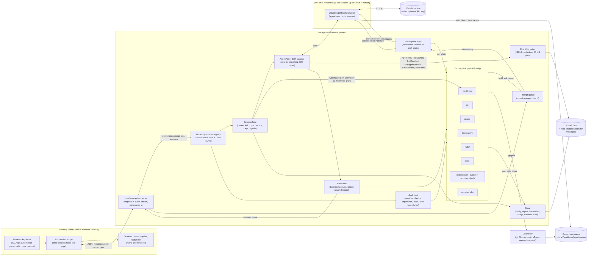

# High-level design — Craft (repo `claude-craft`)

> Source: the approved `docs/SPEC.md` and the owner's spec v2 (`docs/source/spec-v2.md`). This design keeps the owner's architecture (small core + grafts, daemon owns sessions, thin client); it only fills in how the parts connect and where each story lives. Items that need the owner's say are listed at the end.

## In plain words
Craft is four programs working together on your computer:
1. **The window you see** (the desktop client). It only draws things and passes your keys on. If it crashes or you close it, nothing stops.
2. **The background worker** (the daemon). It runs all the Claude agents, keeps their history, and holds every rule (caps, radar, undo). It keeps running when the window is closed. The window starts it if it isn't running.
3. **One helper process per agent** (the Claude Agent SDK sessions). Each agent works in its own copy of your repo (a worktree) on its own branch.
4. **A git helper** that runs git commands in the background so the screen never freezes while git works.

The window and the background worker talk over a private local connection that only your Windows user account can open (a "named pipe"; nothing listens on the network). Inside the background worker, a small **core** does the basics (modes and keys, sessions, the event history, the event bus, the "may this tool call run?" checkpoint, and loading add-ons). Every other feature, from worktrees and git to usage bars, radar, race and the dev team, is a **graft** (an add-on) that uses only the public add-on API. A sample graft in the repo proves on every build that the API is enough.

Three choices are still open and get settled by small experiments in milestone 1: Tauri or Electron for the window, named pipe or localhost for the connection, and Node or Bun for the background worker. My recommendation for each is at the end.

## Problem & goal
Running several Claude agents on one repo today means juggling terminals, losing track of who edits what, and colliding on files. Craft gives one developer one keyboard-first screen to see and control up to 5 agents (plus up to 8 dev-team tasks): each in its own worktree and branch, with live change visibility, fork/race/pick, collision holds, and always-visible usage limits. A daemon owns the sessions so a UI crash never stops an agent (SPEC §1).

## Users & main use cases
- **Owner (solo developer, Windows 11):** start sessions in a repo (F-1), command Craft in LAB (F-2), run a fleet (F-3), land work with git (F-4), watch usage and resume after limits (F-5), get stopped on collisions (F-6), race attempts (F-7), tune grafts (F-8), run the dev team (F-9), copy settings to a second PC (F-10).
- **Graft authors / other developers *(assumed, SPEC §2)*:** write grafts against the public, versioned API; the sample graft is their template.

## Scope
- **In:** everything in SPEC §3 (US-01…US-34), all 10 screens plus the `:settings` panel, the six installed grafts (worktrees, git, usage, keep-warm, radar, race), the three shelf grafts (orchestrator, budget, recorder), the sample graft, hardening (replay harness, soak test, performance budgets in CI). Windows 11 is the tested platform.
- **Out (SPEC §11, copied):** multi-user use; a graft marketplace; model providers other than Claude; a real-terminal (TUI) client (later, behind the same connection); rebuilding the agent loop, tools, permissions or resume; syncing settings/prompts/usage between computers or any cloud storage; moving live sessions or worktrees between computers or running sessions on a server; a Claude review score on by default, or automatic race picks. Also out *(assumed)*: the `user-model` and `prompts` grafts from v2's concept table (no v1 story; the prompts file is only stored and copied, US-32).

## Success metrics
| Metric | Target | Measured by |
|---|---|---|
| Typing latency | < 50 ms with 5 sessions streaming | performance budget test in CI + soak test (M12) |
| UI update rate | batched to about 30/s; long transcripts virtualized | client render budget test (M12) |
| Agent survives the window | closing/killing the client mid-stream loses no event; reopen shows everything | end-to-end test (M3) |
| Crash safety | daemon crash loses at most the last event; every session returns cryo; no worktree deleted without the owner's "d" | crash test (M7) |
| Stability | 1-hour soak with 5 sessions passes on Windows 11, no leaked SDK processes | soak test before each release (M12) |
| Graft API proven | sample graft loads, registers a verb and a panel, and passes the public-API-only check on every build | CI (from M2) |
| Architecture rules | grafts never import the SDK or git, and talk only via the bus; a violation fails CI | dependency-cruiser in CI (from M2) |
| Pushable histories | no pushed history file over 50 MB (G-20) | event log test (M3) |
| Definition of done | all six SPEC §12 checks pass on Windows 11 | owner acceptance |

## Parts that run separately
| Part | Runs as | Lifetime | Talks to |
|---|---|---|---|
| **Desktop client** | Tauri or Electron app with React (spike 4). Its shell process (Electron main, or Tauri's Rust core) holds the daemon connection and forwards to the page; the page never opens the connection itself. | While the window is open | Daemon over the local connection |
| **Daemon** | Node process (recommended; Bun is the alternative), one per Windows user, started by the client if not running, detached so it outlives the client. Single-instance by owning the pipe name. | Until the owner quits it or the PC stops | Client, SDK child processes, git worker, files |
| **SDK child processes** | One Claude Agent SDK session per Craft session (up to 5 own + 8 team), spawned by the AgentPort adapter. On Windows they are put in a job object (or equivalent) so they die with the daemon (spike 5). | One per running session; gone when the session is cryo | Daemon (stdio, via the SDK), Claude service (HTTPS) |
| **Git worker** | Worker thread or child process in the daemon running the git CLI (`--porcelain=v2 -z --no-optional-locks` for status); one write queue per repo so merges, worktree adds and auto-commits never overlap; debounced file watching triggers status. | Same as daemon | Daemon (git port), repo and worktrees on disk |
| **External: Claude service** | Reached only by the SDK sessions (and the race review call through AgentPort). Subscription sign-in by default, API key as fallback (US-31). | — | SDK child processes |
| **External: git remote** | Craft never contacts it *(assumed)*. "Already pushed, can't undo" (US-34) is judged from the local remote-tracking branch, i.e. as of the last push or fetch. | — | — |

### Client ↔ daemon connection
- **Channel:** Windows named pipe `\\.\pipe\craft-<username>` (recommended), reachable only by the current user; on macOS/Linux the same code uses a Unix socket at `~/.craft/daemon.sock` (Node's `net` module handles both). Localhost TCP is the alternative (needs a random token in `~/.craft` and may trigger a firewall prompt).
- **Messages:** newline-delimited JSON, validated with zod on both sides, with a protocol version in the opening `hello`.
- **Daemon → client:** a **state snapshot** on connect (sessions, grammar table, open prompts, panels' state, usage, settings), then an **event stream** with sequence numbers, batched to about 30/s. On reconnect the client sends its last sequence number and gets the missed events, or a fresh snapshot if too much was missed.
- **Client → daemon:** prompt text for a session, resolved LAB commands (count + verb + object + target), `:` commands, prompt answers, settings changes. Each has a request id; the daemon replies ok/error.

## Modules
### Core (daemon unless marked)
| Module | Responsibility | Talks to |
|---|---|---|
| **C1 Modes & grammar registry** | One table of verbs, objects, `:` commands, panel keys and widgets, filled by core and grafts; global key collisions fail at load naming both (check 1); panel keys checked per panel. Command runner executes resolved sentences and `:` commands. **Undo journal**: last 20 undoable actions (merge, prune, pick) recorded by the grafts that did them, persisted, with "already pushed" check via the git port (US-34). Core verbs/objects: f, x, r, u, `.`, s. Core `:` commands: `:sessions`, `:help`, `:repo`, `:settings`, `:graft`. | Graft host (registrations), session host, prompt queue, git port (undo checks), client (table in snapshot) |
| **C1c Client input & modes** *(client)* | TALK/LAB state machine (esc, i/enter), sentence parser against the grammar table from the snapshot, which-key popup, `.` repeat, macros (`qa … q`, `@a`), modal capture: while a prompt is shown every key goes to it. Runs in the client so typing stays under 50 ms. | Client shell, daemon (sends resolved commands and answers) |
| **C2 Session host** | Create, pause (cryo), resume, fork, stop sessions; per-repo session numbering never reused (G-18); own cap (default 5) and a separate team pool (cap 8) (G-13); "Only 2 fit" checks (G-6); offline retry then "cryo · offline" (G-9); "still limited" on early resume (G-16); crash recovery: every recorded session returns cryo, mid-turn ones "interrupted mid-turn" (US-17); sign-in choice (subscription / API key) and the error when sign-in is missing or refused (US-31); repo picker data (recent repos, git-repo and has-commits checks) (US-01). Gets each session's working folder from the **workspace port**, which the worktrees graft provides. | AgentPort, event log, bus, store, workspace port, prompt queue |
| **C2a AgentPort + SDK adapter** | The only code that imports SDK types. Starts/resumes/forks SDK sessions, sends prompts, maps SDK messages to AgentText, ToolStarted, ToolFinished, SubagentStarted, TurnFinished, RateLimit; reads the rate-limit event defensively ("unknown" when missing); hands the SDK permission callback to the interception layer; one-shot Claude call for the race review score. | SDK child processes, session host, interception layer, event log, bus |
| **C2b Event log** | Append-only JSONL per session; the source of truth for resume, fork and replay; atomic appends (a crash loses at most the last event); location by the repo's push answer: in the repo `.craft/sessions/` for "yes", `~/.craft/sessions/<repo>/` for "no" (US-33, G-3); for "yes" repos, blanks key/password-looking text before writing (G-12) and rolls to a new part at 50 MB (G-20). | Session host, AgentPort, store (push answer), files |
| **C3 Event bus** | Typed publish/subscribe across all sessions; bounded queues; approvals, tool results and turn-finished are never dropped, partial text and spinner ticks may be; feeds grafts and the client stream. The only way grafts talk to each other. | Everyone in the daemon; connection server |
| **C4 Interception layer** | Wraps the SDK permission callback; every tool call runs the graft chain in a fixed order (radar, budget, then approvals) and ends allowed, held or denied; logs the decision and the deciding graft (US-18); a held call stays pending until the graft resolves it; if the SDK cannot wait, the call is denied "held too long" *(assumed, spike 2)*. | AgentPort, graft host (chain members), prompt queue, bus, event log |
| **C5 Graft host** | Loads grafts from installed and shelf folders; validates manifests (name, version, apiVersion, provides, needs, capabilities, settings); registry checks 1–4 (collisions, missing needs with install hint, bad settings fall back with a warning, a throwing graft is isolated); capability enforcement (a graft gets only the API handles its leaflet declares); leaflet on install and on capability change (US-24); dose 0–5 with each graft's dose mapping; install from shelf, remove; graft manager screen data (US-23). | Grammar registry, bus, interception layer, store, prompt queue |
| **C6 Prompt queue** | All modal prompts (radar holds, approvals, y/n confirms, push-histories, unknown worktrees, "Only 2 fit") go into one FIFO queue; one shows at a time with "1 of 3" and the session named first (US-08, G-7); an answer resolves only the prompt on screen. Part of the core's modes rule 3. | Client (via snapshot/stream), interception layer, grafts, session host |
| **C7 Store** | Plain files in `~/.craft`, all validated with zod on load (a bad file falls back to defaults with a warning naming it): `config` (settings, doses, per-repo answers keyed by remote address or folder path, G-11), `prompts`, `usage`, a separate credentials file (API key, never in `config`), `repos` (recent repos), daemon state (session records, next number per repo, undo journal) *(assumed: exact layout in LLD)*; each graft gets its own data folder. | Session host, graft host, event log, grafts (through the API) |
| **C8 Connection server** | Named-pipe server; snapshot + sequenced, batched event stream; command intake; reconnect catch-up. | Client, bus, grammar registry, prompt queue |
| **C9 Git port + git worker** | Typed git operations (worktree add/remove/list, status, commit, branch graph, diff, merge, revert merge, rebase, branch delete/restore, remote-tracking check). Grafts call the port, never git. | Git worker process, worktrees/git/radar/race grafts, undo journal |
| **Client shell** *(client)* | Mono-grid renderer with theme tokens; the 10 screens and the settings panel; top bar and statusline built from widgets grafts register; tabs, Parallel and Tiling layouts (US-11); panel host with an error boundary per panel; virtualized transcripts; Startup with the recent-repos list. Graft panels are drawn from each graft's UI part *(see approvals)*. | Client input, daemon connection |

### Grafts (all through the public graft API; default dose in brackets)
| Graft | Responsibility | Talks to (ports / bus) |
|---|---|---|
| **worktrees** [3] | Provides the workspace port: creates `~/.craft/worktrees/<repo-id>/<session>` on `craft/<n>` from the main checkout's last commit (says which uncommitted files are not in it, G-15; separate folders for same-name repos, G-11); auto-commits each turn that changed files with `craft s2 · turn 4: …` and records the commit on TurnFinished (US-09, G-2); `:wt`; worktree column; lists unknown worktrees for "d delete · k keep", never deletes on its own (G-4). | git port, bus (TurnFinished), prompt queue, session host (workspace port) |
| **git** [3] | Branch graph (unmerged above trunk, merged below), branch list, overlap warnings (`:git`); `mb`, `vb`, `:rebase`, `:prune`; confirms naming what changes, untracked files with ignored folders collapsed (G-17, G-22), mid-turn note with `w` wait (G-23); pauses a working session for merge/rebase and resumes it, stops cleanly on conflict (G-14); records merge/prune undo entries (merge back out with a revert commit when main moved, G-5); statusline branch widget (M/S, ahead). | git port, bus, prompt queue, undo journal, session host (pause/resume via API) |
| **usage** [3] | 5-hour and weekly bars with percent, reset time, colour thresholds, tokens and cost; "unknown"; grey "out of date · last seen" (G-21); writes usage history to its data file; marks cryo reset times; `:usage`. | bus (RateLimit, TurnFinished), store |
| **keep-warm** [1] | Pings the focused session on a schedule so its cache stays warm; pings show in usage; `:keep`. | bus, session API (send ping) |
| **radar** [4] | In the interception chain: holds an edit to a file another branch changed (dose 1 log only … 5 hold every cross-branch edit); a/w/d; after `w`, resolves on merge and reopens the prompt if the other branch is dropped (G-8); file ownership with edit heat, change feed, live branch graph (`:radar`). Capabilities: read tool calls, read git status, read worktree paths, hold/deny; no network, transcripts or session starts. | interception layer, bus, git port (read only), prompt queue |
| **race** [3] | `3fs` / `:race`: forks N attempts (via session host fork), runs the repo's test and lint commands (guessed from project files, editable, remembered per repo, G-10), optional Claude review score (off by default), side-by-side cards and fork graph; `pa` with confirm; losers to the graveyard; pick undo entry. | session host (fork), git port, bus, prompt queue, undo journal, AgentPort review call (through the API), store |
| **orchestrator** [shelf] | `:team`: the dev-team-setup flow as a graft: orchestrator chat, phase strip, swimlanes, parallelism strip (cap 8, own pool), task queue with waiting tasks, checkpoints; object `t`. | session host (team pool), bus, prompt queue (checkpoints), git port |
| **budget** [shelf] | Caps cost or tokens per session; in the interception chain, denies tool calls past the cap and shows why; `:budget`. | interception layer, bus |
| **recorder** [shelf] | `:replay` steps through a past session's events from the event log. | event log (read via API), bus |
| **sample-hello** | Sample graft in the repo (`grafts/sample-hello`): registers one verb and one panel; loaded and checked on every build; fails the build if it breaks or reaches outside the public API. | grammar registry, client panel host |

**Dependency rules (CI, dependency-cruiser):** grafts import only the graft API package; only C2a imports the SDK; only C9's worker runs git; grafts never import each other (they use the bus); client code never imports daemon internals (only the shared protocol and graft-UI API types).

## Data flow

(Also saved as `.results/hld/hld.mmd`.)

### Key flows through the parts
- **A turn (F-1):** client sends prompt text → session host → AgentPort → SDK child. SDK messages → adapter → typed events → event log (append, redact/split for "yes" repos) and bus → client stream (batched) and grafts. TurnFinished → worktrees graft commits the turn via the git port and publishes the commit id, which the event log records (used by fork at turn N, US-21).
- **A tool call (F-6):** SDK permission callback → interception layer → radar, budget, approvals in order → any "hold" goes to the prompt queue → the owner answers in the client → allow/deny back to the SDK. Decision logged with the deciding graft (US-18).
- **A LAB sentence (F-2):** keys are parsed in the client against the grammar table (which-key from the same table) → resolved command to the daemon → registry runs the owning core/graft handler → confirms go through the prompt queue → undoable results land in the undo journal.
- **Fork at turn N (US-21, spike 1):** session host asks AgentPort for an SDK session at turn N's conversation point and the workspace port for a new worktree at turn N's commit.
- **Window closed / reopened (US-17):** daemon keeps running; the client reconnects, sends its last sequence number, receives missed events or a new snapshot.
- **Daemon crash / PC restart (US-17):** on start the session host reads its state records; every session becomes cryo (mid-turn ones "interrupted mid-turn"); worktrees graft lists unknown worktrees for "d / k".

## User story → module map
| Story | Module(s) |
|---|---|
| US-01 Startup / repo picker | Client shell, C2 session host, C7 store |
| US-02 TALK chat | C2, C2a, C2b, C3, client shell (file tree from git port status) |
| US-03 TALK/LAB switch | C1c client input |
| US-04 LAB sentences, `.`, `u` | C1c, C1 (command runner, undo journal) |
| US-05 Which-key popup | C1 (table), C1c |
| US-06 Macros | C1c |
| US-07 `:` commands / panels | C1, client shell panel host |
| US-08 Modal prompt queue | C6 prompt queue, C1c modal capture |
| US-09 Worktree + branch per session, per-turn commits, numbering | worktrees graft, C2 (numbering), C9 |
| US-10 Up to 5 sessions, "Only 2 fit" | C2 |
| US-11 Tabs / Parallel / Tiling | Client shell, worktrees (column), git (graph tile) |
| US-12 Git view | git graft |
| US-13 Merge, rebase, prune, review | git graft, C9, C2 (pause/resume) |
| US-14 Usage bars | usage graft |
| US-15 Statusline | Client shell, widgets from git and usage grafts, C2 (session/model) |
| US-16 Cryo, resume, offline retry | C2, C2a, usage graft (reset times) |
| US-17 Survive UI/daemon crash, unknown worktrees | C8 connection server, C2 recovery, C2b, worktrees graft |
| US-18 Interception chain | C4 |
| US-19 Radar hold | radar graft, C4, C6 |
| US-20 Radar panel | radar graft |
| US-21 Fork at any turn | C2, C2a, C2b, worktrees graft (workspace port) |
| US-22 Race | race graft, C2 (fork), C2a (review call), C9 |
| US-23 Graft manager | C5 graft host, client shell |
| US-24 Leaflets / capabilities | C5 |
| US-25 Keep-warm | keep-warm graft |
| US-26 Orchestrator | orchestrator graft, C2 (team pool) |
| US-27 Budget | budget graft, C4 |
| US-28 Recorder | recorder graft, C2b |
| US-29 Sample graft + public-API check | sample-hello, C5, CI architecture checks |
| US-30 Safe failure of grafts | C5, client shell error boundaries |
| US-31 Sign-in / API key | C2, C2a, C7 (credentials file), settings panel |
| US-32 Copyable settings files | C7 |
| US-33 Per-repo push answer, redaction, 50 MB parts | C2b, C7, C6 (first-time prompt) |
| US-34 Confirm + undo until pushed | C1 undo journal, C6, git graft, race graft, C9 |

## Milestones
The owner's 12 milestones (v2 §Build order) are kept as the build order. The template's limit of 4 milestones applies to **risk checkpoints**; the four checkpoints are marked ★ and are where the owner reviews before building on.

| # | Milestone | Outcome (visible) | Stories |
|---|---|---|---|
| 1 ★ | Skeleton and spikes | Client and daemon talk over the chosen local connection on Windows; spikes 1–5 answered (below); Tauri vs Electron, connection and Node vs Bun decided; SDK spike streams one session and reads the rate-limit event; subscription-sign-in terms checked. **Checkpoint: stack locked.** | — |
| 2 ★ | Core scaffolding | Grammar registry with collision checks, AgentPort adapter, event log, bus, graft host loading the sample graft (verb), architecture rules failing CI on a violation. **Checkpoint: graft API v1 and event format locked.** | US-29 (verb + CI), US-30 (checks 1–3) |
| 3 ★ | Single session | Startup repo picker; sign-in; TALK chat with tool output, file tree, statusline; per-repo push prompt and history location; session survives a client restart; the session already runs in its own worktree *(see approvals)*. **Checkpoint: first end-to-end flow.** | US-01, 02, 15, 17 (client part), 31, 33, 32 (config/credentials files) |
| 4 | LAB and grammar | Modes, counts, verbs, objects, which-key, `:` commands, macros, prompt queue; sample graft's panel; panel error boundaries. | US-03–08, US-29 (panel), US-30 (check 4) |
| 5 | Worktrees and git | Worktree + branch per session with per-turn commits and `:wt`; branch graph; merge, rebase, prune, review diff with confirms; undo journal; unknown-worktree listing. | US-09, 12, 13, 34 (merge, prune) |
| 6 | Parallel and tiling | Up to 5 sessions, "Only 2 fit", tabs, Parallel and Tiling layouts. | US-10, 11 |
| 7 | Usage and halt/resume | Limit bars, cost, stale marks, cryo and resume after reset, offline retry, crash recovery to cryo. | US-14, 16, 17 (daemon crash) |
| 8 | Interception and radar | Tool calls pass the chain; overlap hold prompt end to end; file ownership view. | US-18, 19, 20 |
| 9 | Fork and race | Fork from any turn, N attempts, tests/lint, optional review score, `pa` pick with undo, graveyard. | US-21, 22, 34 (pick) |
| 10 | Graft manager | Dose dials, leaflets, shelf, install and remove, keep-warm, budget and recorder from the shelf. | US-23, 24, 25, 27, 28, 32 (doses copy) |
| 11 | Orchestrator graft | `:team` runs the dev-team-setup flow with phases, lanes, queue, checkpoints, team pool of 8. | US-26 |
| 12 ★ | Hardening | Replay harness, 1-hour soak test with 5 sessions on Windows, performance budgets in CI. **Checkpoint: before release.** | §9 non-functional |

Owner's note kept: milestones 1–7 already give a usable single-user tool.

### Milestone-1 spikes
| # | Question | Pass means | If it fails |
|---|---|---|---|
| 1 | Can the SDK fork a session at a past turn, and can we restore repo state? | A new SDK session continues from turn N's conversation; a worktree at turn N's commit matches | Fork re-feeds the transcript up to turn N into a fresh session (slower, uses limits) — owner decision |
| 2 | Can the permission callback hold a call for minutes without timing out? | A call held 10 min then allowed proceeds | Hold denies with "held too long" after the SDK's limit *(assumed in SPEC F-6)* |
| 3 | Are rate-limit event fields stable and complete for both bars? | Both 5-hour and weekly utilization and reset times arrive | Bars show "unknown" for what is missing; contract test pins the shape |
| 4 | Tauri or Electron: memory with 5 streaming sessions + a canvas branch graph, and how the shell process reaches the named pipe | Both measured on Windows 11; typing < 50 ms | Pick the one that passes |
| 5 | Can 5 parallel SDK child processes be cleaned up reliably when the daemon crashes (Windows)? | Killing the daemon leaves no SDK processes running | Daemon start sweeps leftover processes it recorded |
| + | Windows connection: named pipe vs localhost (reach, per-user access, reconnect) | Client reconnects after daemon restart; another user can't connect | Use localhost + token |
| + | Subscription sign-in terms for third-party apps (v2 risk, before M3) | Terms allow it | API key becomes the documented default |

## Risks & assumptions
| Risk | Impact | Mitigation |
|---|---|---|
| Subscription sign-in in third-party apps refused | Owner can't use the subscription | API-key fallback (US-31); terms checked in M1 |
| SDK can't fork at a past turn (spike 1) | US-21 and race change shape | Transcript re-feed fallback; decided at checkpoint 1 |
| SDK permission callback can't wait minutes (spike 2) | Radar `w` weakens | "held too long" denial; radar warns at a shorter time |
| Rate-limit event shape changes | Usage bars break | Defensive reader, "unknown", contract test |
| Tauri page can't reach a named pipe directly | Extra bridging code | Shell process holds the connection in either framework (design rule above) |
| Leftover SDK processes on Windows after a crash | Burned limits, locked worktrees | Job object / process records swept on start (spike 5) |
| Git operations on the same repo overlap (auto-commit vs merge) | Corrupt index, failed merges | Per-repo write queue in the git worker |
| Graft capability list too narrow for first-party grafts | Grafts must bypass the API, breaking the CI rule | Extend the capability list before the API freezes in M2 *(see approvals)* |
| 12 milestones | Never reaches v1 | Usable after M7; checkpoints at M1, M2, M3, M12 |
| Redaction misses a secret | A "yes" repo's history leaks it | Stated in SPEC §13; owner chooses "yes" per repo |

Assumptions *(assumed)*: Craft never contacts the git remote (pushed = local remote-tracking branch); daemon state layout is left to the LLD; the radar → budget → approvals chain order; one daemon per Windows user; client starts the daemon, nothing starts it at Windows login.

## Needs the owner's approval
1. **Desktop window technology: Tauri or Electron** — decided by spike 4. Lean: **Electron**, because its shell already runs Node, so the pipe connection, the daemon launch and the shared protocol code are the same language and library; Tauri is lighter on memory but needs a Rust bridge for the pipe and a bundled Node runtime for the daemon. Final pick after the spike's numbers.
2. **Local connection on Windows: named pipe (recommended) or localhost.** A named pipe is private to your Windows account and opens no network port; localhost needs a password file and may pop a firewall prompt. Unix socket stays for macOS/Linux, same code.
3. **Daemon runtime: Node (recommended) or Bun.** The Claude Agent SDK is built and tested on Node, and Node's Windows support for pipes and child-process cleanup is the most proven.
4. **Graft capability list gaps (graft API change, before it freezes in M2).** The v2 list has no capability for: running commands in a worktree (race runs tests/lint), changing git (git graft merges, rebases, prunes; worktrees graft creates worktrees and commits), sending a message to a session (keep-warm pings), and pausing/resuming a session (git graft, G-14). Proposal: add `run commands`, `change git`, `prompt sessions`, `control sessions`, all shown on leaflets.
5. **Grafts have a screen part.** Panels, widgets and the graft manager need code that runs in the window, so a graft package gets two entries: a daemon entry (logic) and a UI entry (panel/widget drawing using only the client-side graft API). Approve this reading of v2's "an entry module".
6. **Single session already runs in its own worktree in milestone 3** (v2 puts worktrees in M5). Otherwise the M3 agent would edit your main checkout, which the spec rules out (§13). Only creation moves to M3; `:wt`, per-turn commits, unknown-worktree listing stay in M5.
7. **Milestones kept at 12** with four review checkpoints (M1, M2, M3, M12), rather than regrouped.
