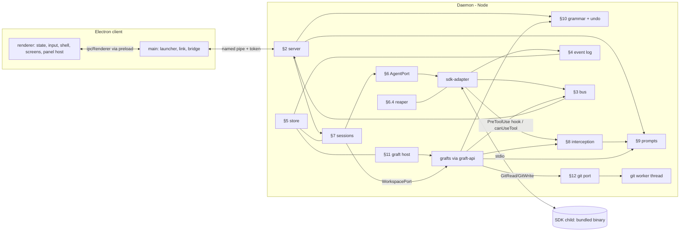
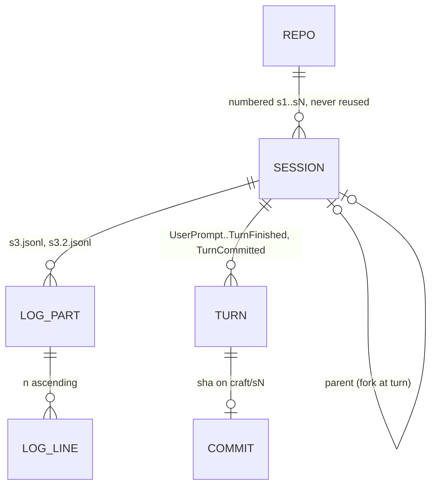

# Low-level design — Craft (repo `claude-craft`)

> Every section is numbered and self-contained, so a task can be briefed with only the
> sections it needs (e.g. `LLD §8, §9`). Each module section holds its responsibility,
> interfaces, contracts and schema in one place; it refers to other modules only by number.
> **Numbers are stable**: at milestone as-built syncs and change requests, update sections in
> place and give new sections new numbers. Never renumber; mark removed sections `(removed)`.
> **Size cap**: large, 900 lines. Source of truth above this: `docs/HLD.md` (approved), `docs/SPEC.md`,
> DECISIONS D-01..D-15. HLD module ids (C1…C9) are given in brackets for tracing.

## §0 Overview

### §0.1 Stack
| Layer | Choice | Why | Rejected alternative |
|---|---|---|---|
| Language | TypeScript 6.0.x, strict, ESM | Same language as SDK, daemon, UI; 6.0 because TS 7.0 has no compiler API for lint/depcruise (research §4) | TS 7.0.x (tooling can't load it yet) |
| Daemon runtime | Node 24 (dev/CI: Node 24.22.3; packaged: Electron's built-in Node via `ELECTRON_RUN_AS_NODE=1`) | SDK built on Node; one runtime shipped (D-15) | Bun; shipping a second Node |
| Agent | `@anthropic-ai/claude-agent-sdk` 0.3.332 exact, behind §6 only | SPEC §8 | — |
| Client | Electron 45 + React 19 (spike 4 confirms) | Main process speaks the pipe in TS (D-15) | Tauri 2 (Rust pipe bridge + Node sidecar) |
| Rendering | DOM mono grid (fixed cell, theme tokens) + Canvas 2D for branch graph / heat; `@tanstack/react-virtual` for transcripts | React components stay testable; canvas only where many small shapes | Full canvas cell renderer; xterm.js |
| IPC | Named pipe `\\.\pipe\craft-<user>` (Unix socket elsewhere), NDJSON + zod, **token handshake** (§2) | D-12; pipe ACL is not user-private (research §3.3) | Localhost TCP |
| Validation | zod 4 everywhere (wire, files, manifests) | SDK peer dep is zod 4 | — |
| Git | git CLI in a `worker_threads` worker, per-repo write queue (§12) | SPEC §9 | isomorphic-git / libgit2 bindings |
| Build | pnpm workspaces; Vite for renderer, Electron main and daemon bundles (`import.meta.glob` discovery) | One bundler; glob discovery keeps registries one-file-per-entry | Turborepo/Nx; tsc-only (no glob) |
| Tests | vitest (unit/integration), Playwright Electron (e2e), replay harness (§17) | SPEC §10 | Jest |
| Arch checks | dependency-cruiser (§0.3) | SPEC §10 | eslint-plugin-boundaries |

### §0.2 Folder structure
```
claude-craft/
  package.json  pnpm-workspace.yaml  tsconfig.base.json  eslint.config.js  .prettierrc.json
  .dependency-cruiser.cjs  vitest.config.ts  playwright.config.ts  scripts/check.sh  scripts/setup-tools.sh  .env.example
  packages/
    protocol/src/        wire.ts events.ts errors.ts ids.ts settings.ts version.ts address.ts index.ts (§1)
    graft-api/src/       manifest.ts capabilities.ts context.ts ports.ts define.ts index.ts      (§11)
    graft-ui/src/        panel.ts theme.ts grid/*.tsx index.ts                                  (§14)
    daemon/src/
      main.ts            composition root (only place that news concrete classes)
      domain/            pure logic, no I/O: repo-key, numbering, caps, redact, sentence, chain-order, session-fsm
      server/ (§2)  bus/ (§3)  eventlog/ (§4)  store/ (§5)  auth/ (§6.3)
      agent/ (§6)   agent/sdk-adapter/ (only SDK import)   process/ (§6.4 reaper, command runner)
      sessions/ (§7)  intercept/ (§8)  prompts/ (§9)  grammar/ (§10)  undo/ (§10.4)
      grafts/ (§11)  git/ (§12)  git/worker/  watchdog/ (§16)  log/ (§16)
    daemon/tests/<module>/   daemon/tests/_support/   (fakes, temp-repo helper)
    client/src/
      main/              launcher.ts link.ts bridge.ts window.ts index.ts          (§13.1)
      preload/index.ts
      renderer/          app.tsx state/ input/ shell/ panels/ screens/<id>/ theme/ (§13.2–13.6)
    client/tests/<area>/  client/tests/e2e/
  grafts/<name>/         graft.json  daemon/index.ts  ui/index.tsx  tests/          (§15)
    worktrees git usage keep-warm radar race orchestrator budget recorder sample-hello
  tools/
    replay/  check-graft/  perf/ (budgets.json + bench)  soak/                     (§17)
```
**Workspace imports (CR-1).** Each library package (`@craft/protocol`, `@craft/graft-api`, `@craft/graft-ui`) has `"main"` and `"exports": {".": "./src/index.ts"}` (TS source, no build step; `exports` blocks deep paths). Every package that imports one lists it as `"@craft/<name>": "workspace:*"` in its own `package.json` and imports the bare name (`from "@craft/protocol"`). Now: daemon, client, graft-api, graft-ui → protocol; each graft/tool adds its own when first created. pnpm links `node_modules/@craft/<name>` → `packages/<name>`.
| Consumer | How `@craft/protocol` resolves |
|---|---|
| tsc (`moduleResolution: Bundler`, `allowImportingTsExtensions`) | symlink → `exports` → `packages/protocol/src/index.ts`; one program, no `.d.ts` |
| vitest (root `vitest.config.ts`) | Vite follows the symlink to its real path (outside `node_modules`), so the source is transformed inline and is the same module instance as before; no alias needed |
| Electron main / preload / renderer (Vite builds) | bundled from source; main/preload builds keep `@craft/*` in `ssr.noExternal` (`/^@craft\//`); type-only imports are erased (sandboxed preload stays self-contained) |
| Daemon at runtime | never resolves the name: the launcher (§2.3) runs the Vite bundle `daemon/dist/main.js` with protocol inlined; electron-builder ships only `dist/` |
| dependency-cruiser | resolves to the real path (`preserveSymlinks: false`, the default), so §0.3 rules keyed on `^packages/protocol/` still match |

### §0.3 Layer map, dependency rules, composition root
```
client/renderer ──► graft-ui ──► protocol        grafts/*/ui ──► graft-ui, react
client/main ─────► protocol                      grafts/*/daemon ──► graft-api ──► protocol
daemon/main.ts ──► every daemon module (wiring only)
daemon module (§2–§12) ──► other modules' index.ts (interfaces) ──► domain/ ──► protocol
```
- **Composition root:** `packages/daemon/src/main.ts` builds every core service, passes interfaces in constructors, then starts the graft host. Client: `client/src/main/index.ts` and `renderer/app.tsx`.
- **Variation points with interfaces:** `AgentPort` (§6), `ToolGate`/`ApprovalGate` (§8), `WorkspacePort` (§7.1, provided by a graft), `GitRead`/`GitWrite` (§12), `ProcessReaper` (§6.4), `Transport` (§2, pipe vs Unix socket), `Clock` (replay), `FileSystem` for store (fakes in tests).

dependency-cruiser `forbidden` rules (all `severity: error`; in `.dependency-cruiser.cjs`):
| Rule | from | to (forbidden) |
|---|---|---|
| `graft-public-api-only` | `^grafts/[^/]+/daemon` | anything except `^packages/(graft-api\|protocol)`, `zod`, same graft folder |
| `graft-ui-public-api-only` | `^grafts/[^/]+/ui` | anything except `^packages/(graft-ui\|protocol)`, `react`, same graft folder |
| `graft-no-cross-graft` | `^grafts/([^/]+)/` | `^grafts/(?!$1/)` |
| `graft-no-node-io` | `^grafts/` | `^node:(fs\|child_process\|net\|http\|https\|worker_threads\|dgram)`, `^(fs\|child_process\|net\|http\|https)$` |
| `sdk-only-in-adapter` | not `^packages/daemon/src/agent/sdk-adapter/` | `@anthropic-ai/claude-agent-sdk` |
| `spawn-only-in-allowed` | not `^packages/daemon/src/(git/worker\|agent/sdk-adapter\|process)/` | `node:child_process` |
| `domain-is-pure` | `^packages/daemon/src/domain/` | `^node:`, any daemon module outside `domain/` |
| `module-via-index` | `^packages/daemon/src/([^/]+)/` | `^packages/daemon/src/(?!$1/)[^/]+/(?!index\.ts$)` (deep imports into another module) |
| `client-not-daemon` | `^packages/client/` | `^packages/daemon/`, `^packages/graft-api/` |
| `renderer-no-node` | `^packages/client/src/renderer/` | `^node:`, `electron`, `^packages/client/src/main/` |
| `protocol-leaf` | `^packages/protocol/` | anything except `zod` |
| `graft-api-leaf` | `^packages/graft-(api\|ui)/` | `^packages/(daemon\|client)/`, `^grafts/` |
| `no-circular` | any | circular |
| `no-relative-cross-package` (CR-1) | `^(packages\|grafts\|tools)/([^/]+)/` | `dependencyTypes: ['local']` into `^(packages\|grafts\|tools)/` other than `$1/$2/` (import another package by name) |
| `workspace-dep-declared` (CR-1) | any | `dependencyTypes: ['npm-no-pkg', 'npm-unknown']` (`@craft/*` used but not in that package's `package.json`) |

### §0.4 Packages
Pins checked 2026-11-25 (research §4). "pin at install" = exact version written to the lockfile by env-setup, no range.
| Package | Version | Purpose | Alternative rejected | Tag |
|---|---|---|---|---|
| Node.js | 24.22.3 | Dev/CI runtime; matches Electron 45's Node | Node 26 | toolkit |
| pnpm | 12.23.0 | Workspaces | npm workspaces | toolkit |
| typescript | 6.0.3 (latest 6.0.x) | Compiler / types | 7.0.2 (no compiler API) | toolkit |
| @anthropic-ai/claude-agent-sdk | 0.3.332 exact | Agent loop | — | trade-off |
| zod | 4.6.7 | Validation (SDK peer) | zod 3 | toolkit |
| electron | 45.5.0 | Desktop shell, packaged daemon runtime | Tauri 2.12 | trade-off |
| electron-builder | 26.18.0 | Windows NSIS per-user installer | Electron Forge 8 | trade-off |
| react, react-dom | 19.3.1 | UI | — | toolkit |
| vite | 8.3.8 | Bundler (renderer, main, daemon) | electron-vite, tsup | toolkit |
| @vitejs/plugin-react | pin at install | JSX for Vite | — | toolkit |
| @tanstack/react-virtual | 3.14.28 | Virtualized transcripts/lists | react-virtuoso | trade-off |
| koffi | pin at install (spike 5 chose tier B, so needed; owner approval pending at the `process/` task) | Windows job object calls (§6.4) | small Rust/C helper exe | trade-off |
| write-file-atomic | pin at install | Atomic JSON writes with Windows rename retry | own temp+rename | toolkit |
| vitest, @vitest/coverage-v8 | 5.1.1 | Tests + coverage | Jest | toolkit |
| @playwright/test | pin at install | Electron end-to-end and latency budget tests | WebdriverIO | toolkit |
| dependency-cruiser | 18.9.0 | Layer rules (§0.3) | eslint-plugin-boundaries | toolkit |
| eslint, typescript-eslint | eslint pin at install (9.x); typescript-eslint 8.74.0 | Lint incl. complexity/size rules (works with TS < 6.1) | Biome 2.6.9 (no exact cyclomatic/max-lines rules) | toolkit |
| eslint-plugin-react-hooks | pin at install | Hook rules | — | toolkit |
| prettier | pin at install | Format | Biome formatter | toolkit |
| gitleaks (binary) | pin at install | Secret scan in check.sh | detect-secrets | toolkit |
No state library (own store on `useSyncExternalStore`), no CSS framework, no logger library (§16), no ID library (`crypto.randomUUID`).

### §0.5 Config and secrets
- No `.env` is needed to run Craft; settings live in `~/.craft/config/` (§5). `.env.example` documents dev-only vars: `CRAFT_HOME` (override `~/.craft` for tests), `CRAFT_PIPE` (override pipe name), `CRAFT_LOG_LEVEL`, `ANTHROPIC_API_KEY` (only for live spike/contract tests; never read by the daemon at runtime).
- The API key lives only in `~/.craft/credentials.json` (§5), outside `config/`, never logged; UI shows `…` + last 4.
- **Sign-in hard rules** (research §2): Craft never reads, stores or forwards Claude account tokens, never reads `~/.claude` credential files, never alters the bundled binary, never says "Claude Code" in product text.

### §0.6 Component diagram
Saved as `.results/plan/diagrams/components.mmd`.


### §0.7 Milestone-1 spikes and how each result changes the design
| # | Spike | Pass | Fail → design change |
|---|---|---|---|
| 1 | Fork: `forkSession(id,{upToMessageId})` then `resume` in a **different worktree cwd** on Windows | New session continues from turn N; worktree at turn N's sha (§7.4) | (a) lookup fails across cwd → add a `sessionStore` adapter in §6 mirroring transcripts under `~/.craft/sdk-sessions/`; (b) fork unsupported → §7.4 uses transcript re-feed (owner decision: slower, uses limits) |
| 2 | Hold a `PreToolUse` hook promise 10 min, and `canUseTool` 10 min | Call proceeds after allow | Hidden timeout → §8 sets hook `timeout` below it and on expiry returns `defer`; session shows "parked", answer resumes it (§7.3 `resume`) |
| 3 | `rate_limit_event` under both sign-in methods; fields `unifiedWindows.five_hour/seven_day`, units | Both windows present | Missing window → that bar "unknown" (§15.3); contract test pins observed shape; absent under API key → bars show tokens/cost only |
| 4 | Electron vs Tauri: memory + keystroke-to-paint with 5 replayed streams + canvas graph | Electron < 50 ms p95 | Electron over budget → Tauri: only `client/src/main/` is rewritten (Rust pipe bridge + Node sidecar); renderer, protocol unchanged |
| 5 | Kill daemon (Task Manager "End task" and `taskkill /F`) with 5 sessions each running a tool child | No `claude`/tool processes left | Decides §6.4 tier: libuv job enough → no koffi; else daemon self-job via koffi; koffi fails under Electron-as-Node → helper exe wrapper via `spawnClaudeCodeProcess` |
| + | Pipe: single instance, reconnect after daemon restart, second Windows user can't read `%USERPROFILE%\.craft\daemon.token` nor pass the handshake | All hold | Profile readable by others → token file gets explicit ACL via `icacls` at first run (§2.3); still failing → owner decision (localhost alternative is no better) |
| + | Sign-in: `claude-login` path works with the SDK's bundled binary when the owner signed in through Anthropic's flow; error shape when not signed in / refused | Session starts; errors classified (§6.2) | Refusal shape unknown → map any auth failure to `AUTH_REJECTED` with the API-key hint |

**M1 results (as built; details and fixtures in `docs/spikes/sdk.md`, `docs/spikes/shell.md`):**
| # | Result | Branch taken |
|---|---|---|
| 1 | PASS: fork cut at turn N, `resume` works in a different cwd (plain dirs; worktree-at-sha not exercised) | Pass branch: §7.4 as written, **no `sessionStore` adapter**, no re-feed. Pass `dir` = original cwd to `forkSession` |
| 2 | PASS: hook (with `timeout: 86_400`) and `canUseTool` both held 600 s, tool then ran | No `defer`/parked fallback. Holds > 600 s and the default hook timeout are **untested**; keep the explicit `timeout` |
| 3 | PARTIAL: claude-login shape captured (`unifiedWindows.five_hour/seven_day`, `utilization` fraction 0..1, `resetsAt` Unix s; `unifiedWindows` not in SDK types); api-key **not captured** (no key) | §6.2 structural read confirmed; keep "absent under API key → tokens/cost only"; contract test must accept zero events |
| 4 | Electron 45.5.0 p95 key-to-paint 17.3–18.4 ms (budget 50), ~390 MB WS; Tauri **not measured** (D-23) | Electron locked (D-24); Tauri fallback not needed |
| 5 | Tier A FAILS (grandchildren survive: libuv job allows silent breakaway); tier B (emulated) leaves 0 | **Tier B** (§6.4). `koffi` still needs owner approval at the `process/` task; koffi load under the shipped runtime untested (fails → tier C) |
| + sign-in | PASS: claude-login runs on the unmodified bundled binary; not-signed-in and bad-key shapes recorded | §6.2 mapping refined (`Not logged in` → `AUTH_MISSING`). §6.3 api-key precedence finding **UNCONFIRMED**, §6.3 unchanged until a clean-env re-run |

## Frozen after the foundation
The foundation tasks (M1–M2) build these complete; feature tasks never edit them (changes go through a change request):
- `packages/protocol/src/**` (core events and wire; graft events live in each graft)
- `packages/graft-api/src/**`, `packages/graft-ui/src/**` (graft API v1, D-09/US-29)
- `packages/daemon/src/main.ts`, `domain/**`, `bus/**`, `store/**`, `server/**`, `log/**`, `prompts/**`
- `packages/daemon/src/grafts/**` (loader discovers `grafts/*/graft.json` by glob; no list to edit)
- `packages/client/src/main/**`, `preload/**`, `renderer/app.tsx`, `renderer/state/**`, `renderer/theme/**`, `renderer/shell/**`, `renderer/panels/host.tsx` (screens found by `import.meta.glob('./screens/*/index.tsx')`, graft UIs by `glob('/grafts/*/ui/index.tsx')`)
- Test support: `packages/daemon/tests/_support/**`, `packages/client/tests/_support/**`, `tools/replay/**`
- Root configs (gates; env-setup owns them): `tsconfig*.json`, `eslint.config.js`, `.dependency-cruiser.cjs`, `vitest.config.ts` (root; replaces `vitest.workspace.ts`), `playwright.config.ts`, `scripts/check.sh`, `scripts/setup-tools.sh`, `tools/perf/budgets.json`
- CR-1 (D-25) is the change request that reopens: `packages/protocol/src/{wire,address,index}.ts`, `packages/*/package.json` (`workspace:*` deps, `exports`), every file with a relative protocol import (codemod), `daemon/src/main.ts`, `server/{commands,connection,transport,snapshot}.ts`, `client/src/main/{link,config}.ts`, `.dependency-cruiser.cjs` (env-setup), `pnpm-lock.yaml` (env-setup). Frozen again when CR-1 merges.
- Registries are one file per entry: graft = folder; screen = folder; core `:` commands = `packages/daemon/src/grammar/commands/<name>.ts` (glob); store migrations = `store/migrations/<file>-<from>-<to>.ts` (glob); tests per feature folder.

## §1 Protocol (`packages/protocol`)
- **Responsibility:** Wire messages, core event types, error codes and settings schema shared by daemon, client and grafts. Pure zod + types.
- **Depends on:** none (zod).

### §1.1 Ids and envelope
```ts
export const PROTOCOL_VERSION = 1;
export type RepoId = string;                 // repo folder slug, e.g. "notes-app", "api-2" (§5.2)
export type SessionKey = `${RepoId}/s${number}`;   // "notes-app/s3"; display "s3"
export interface StreamEvent<T extends string = string, D = unknown> {
  seq: number; ts: string; sid?: SessionKey; type: T; data: D;   // seq: global per daemon epoch
}
export interface LogLine<T extends string = string, D = unknown> {
  v: 1; n: number; ts: string; type: T; data: D;                 // n: per-session, file = session (§4)
}
```

### §1.2 Core events
Critical = never dropped by the bus (§3) or stream batching (§2). Logged = written to the session log (§4).
| type | data | Crit. | Logged |
|---|---|---|---|
| `SessionCreated` | `{repoId, n, branch, worktree, model, pool:'own'\|'team', parent?:{sid, turn, batch}, baseSha, history:'repo'\|'home'}` | ✔ | ✔ |
| `SessionState` | `{state: SessionStateName, cryo?: {reason:'limit'\|'stopped'\|'offline'\|'interrupted'\|'daemon-restart'\|'parked', resetsAt?: string, message?: string}}` | ✔ | ✔ |
| `UserPrompt` | `{turn, text, origin:'owner'\|'graft:<name>'}` | ✔ | ✔ |
| `AgentText` | `{turn, msgId, text, partial: boolean, agentId?}` | complete only | complete only |
| `ToolStarted` | `{turn, toolUseId, tool, input (≤8 KB), paths: string[], agentId?}` | ✔ | ✔ |
| `ToolDecision` | `{toolUseId, decision:'allowed'\|'held'\|'denied', by: string, reason?}` | ✔ | ✔ |
| `ToolFinished` | `{toolUseId, ok, output (≤16 KB)}` | ✔ | ✔ |
| `SubagentStarted` | `{turn, agentId, description}` | ✔ | ✔ |
| `TurnFinished` | `{turn, outcome:'success'\|'error'\|'interrupted'\|'limit'\|'offline', lastMessageId, tokens:{in,out,cacheRead,cacheWrite}, costUsdTotal, durationMs, error?: ErrorCode}` | ✔ | ✔ |
| `TurnCommitted` | `{turn, sha: string\|null}` | ✔ | ✔ |
| `RateLimit` | `{status:'allowed'\|'allowed_warning'\|'rejected'\|'unknown', fiveHour?: Window, sevenDay?: Window, resetsAt?}` with `Window={utilization:number, resetsAt:string}` | ✔ | ✔ |
| `GitStatusChanged` | `{modified, staged, untracked, ahead, files: {path, code}[] (≤2000)}` | latest-wins | ✗ |
| `Spinner` | `{}` | ✗ | ✗ |
| `PromptQueueChanged` | `{head?: OpenPrompt, count}` (§9) | ✔ | ✗ |
| `PanelState` | `{graft, panel, state: unknown}` | latest-wins | ✗ |
| `GraftStatus` | `{graft, status:'loaded'\|'disabled'\|'error'\|'awaiting-leaflet', message?}` | ✔ | ✗ |
| `Notice` | `{level:'info'\|'warn'\|'error', text, code?: ErrorCode}` | ✔ | if `sid` |
| `DaemonStarted` | `{epoch, recovered: SessionKey[]}` (after recovery, before grafts' first prompts) | ✔ | ✗ |
| `<graft>/<name>` | graft events, schema declared in the graft (§11.2) | per declaration | if `sid` |
`SessionStateName = 'starting'|'idle'|'running'|'retrying'|'paused'|'cryo'|'graveyard'|'failed'`.

### §1.3 Wire messages (NDJSON, one JSON object per line, ≤ 1 MB per line)
| Dir | type | fields |
|---|---|---|
| C→D | `hello` | `protocol, clientVersion, clientNonce` (32 B base64 = exactly 44 chars, zod `length(44)`) |
| D→C | `challenge` | `daemonVersion, epoch, serverNonce` (32 B base64, `length(44)`), `proof = HMAC(token, "daemon:"+clientNonce)` |
| C→D | `auth` | `proof = HMAC(token, "client:"+serverNonce), resume?: {epoch, lastSeq}` |
| D→C | `snapshot` | `SnapshotReply` fields: `seq, state: Snapshot` |
| D→C | `events` | `items: StreamEvent[]` (ascending seq, batched ≤ 30/s) |
| D→C | `resync` | `{}` — client must send `cmd snapshot.get` |
| C→D | `cmd` | `id, name: CommandName, args` |
| D→C | `reply` | `id, ok: true, data?` or `id, ok: false, error: {code: ErrorCode, message}` |
| D→C | `bye` | `code, message` then close |
`Snapshot = {sessions: SessionView[], repos: RepoView[], grammar: GrammarTable (§10), prompt: {head?, count}, panels: Record<"graft/panel", unknown>, grafts: GraftView[], usage?: unknown, settings: PublicSettings, signIn: SignInStatus}`.

`CommandName` (args validated by zod in protocol): `snapshot.get`, `repo.list`, `repo.open {path}`, `repo.forget {repoKey}`, `session.create {repoId, prompt, model?}`, `session.prompt {sid, text}`, `sentence.run {count, verb, object?, target?: Target}`, `command.run {name, args?}`, `prompt.answer {promptId, key}`, `panel.action {graft, panel, action}`, `settings.set {path, value}`, `signin.setMethod {method}`, `signin.setApiKey {key}`, `signin.openClaudeLogin {}`, `graft.setDose {name, dose}`, `graft.install {name}`, `graft.remove {name}`, `graft.acceptLeaflet {name}`, `daemon.restart {}`. `Target = {sid?, branch?, attempt?, panel?, selection?}`.

**`snapshot.get` reply (CR-1):** `data: SnapshotReply`, with `snapshotReplySchema = z.object({seq: z.number().int().nonnegative(), state: snapshotSchema})` exported from `wire.ts`; the wire `snapshot` message is the same schema plus `type`. `seq` is **required**: the highest event seq whose effects `state` contains (no later ones). Additive to the message set, but it changes the reply body (was a bare `Snapshot`); `PROTOCOL_VERSION` stays 1 because nothing has shipped. From the first release on, any change to a reply body bumps `PROTOCOL_VERSION`.

### §1.4 Error codes (`errors.ts`)
`ErrorCode` union + `CraftError extends Error {code, userMessage, details?}`. User messages are fixed templates in §16.1.

### §1.5 Daemon address (`address.ts`, CR-1)
```ts
export interface AddressInput { platform: string; username: string; home: string; override?: string | undefined }  // override = CRAFT_PIPE
export function daemonAddress(i: AddressInput): string
```
Pure (no `node:*`, `protocol-leaf`). Override set: on `win32` prefix `\\.\pipe\` if missing, else as given. No override: `win32` → `\\.\pipe\craft-<username>`; else `<home without trailing />/daemon.sock`. The only implementation: daemon `main.ts` and client `main/config.ts` both call it (callers pass the injected env's `CRAFT_PIPE`, platform, username, `CRAFT_HOME`-resolved home); `server/transport.ts` `defaultAddress` is deleted.

## §2 Connection (daemon `server/` [C8] + client `main/link.ts`)
- **Responsibility:** Authenticated pipe connection, snapshot + sequenced batched stream, command intake, reconnect catch-up.
- **Path(s):** `packages/daemon/src/server/`, `packages/client/src/main/{launcher,link,bridge}.ts`
- **Depends on:** §1, §3 (subscribe), §10 (command dispatch), §5 (token file).

### §2.1 Interfaces
```ts
interface Transport { listen(onConn: (s: Duplex) => void): Promise<void>; address: string }   // NamedPipeTransport | UnixSocketTransport
interface CommandHandler<N extends CommandName> { name: N; run(args: CommandArgs<N>, ctx: CmdCtx): Promise<unknown> }
class ConnectionServer { constructor(t: Transport, bus: Bus, snapshot: () => Snapshot, cmds: CommandRouter, token: TokenFile); start(): Promise<void> }
class StreamRing { push(e: StreamEvent): void; since(seq: number): StreamEvent[] | 'gone' }  // 20 000 events
function takeSnapshot(bus: Pick<Bus, 'lastSeq'>, read: () => Snapshot): SnapshotReply  // server/snapshot.ts (CR-1): handshake + snapshot.get
// client main
class DaemonLink extends EventEmitter { connect(): Promise<void>; send(cmd): Promise<Reply>; close(): void }  // emits 'snapshot','events','state'
class DaemonLauncher { ensureRunning(): Promise<void> }
```

### §2.2 Key sequence: client reconnect
Saved as `.results/plan/diagrams/seq-client-reconnect.mmd`.
```mermaid
sequenceDiagram
  participant R as Renderer
  participant L as Client main (DaemonLink)
  participant S as Daemon server
  participant B as Bus/StreamRing
  Note over L,S: pipe closed (client crash, or daemon restart)
  L->>R: state = reconnecting (statusline)
  loop backoff 250 ms → 5 s
    L->>S: connect pipe craft-USERNAME
  end
  alt connect refused for 10 s
    L->>L: DaemonLauncher.ensureRunning() (spawn detached daemon)
  end
  L->>S: hello {protocol, clientNonce}
  S->>L: challenge {epoch, serverNonce, proof}
  L->>L: verify proof with ~/.craft/daemon.token (else bye: possible impostor)
  L->>S: auth {proof, resume:{epoch, lastSeq}}
  S->>B: since(lastSeq) if epoch matches
  alt same epoch and lastSeq in ring
    S->>L: events [lastSeq+1 …]
  else new epoch or too old
    S->>L: snapshot {seq, state}
  end
  L->>R: apply; state = connected
  S-->>L: events (batched ~30/s)
```

### §2.3 Contracts and rules
- **Pipe name:** `\\.\pipe\craft-<username>`; non-Windows `~/.craft/daemon.sock`. Override `CRAFT_PIPE`. Both sides compute it with §1.5 `daemonAddress()`.
- **Snapshot seq (CR-1):** the daemon builds every snapshot (handshake and `snapshot.get`) with `takeSnapshot`, reading `bus.lastSeq()` and the state in one synchronous step (no `await` between), so `seq` matches `state`. Events with seq > `seq` are written to the socket only after the reply (the feed flushes on a later timer tick). Client `DaemonLink`: on `resync`, set `needsSnapshot = true` and send `snapshot.get`; on an ok reply, `lastSeq = max(lastSeq, reply.seq)`, emit `snapshot {seq: reply.seq}`, clear `needsSnapshot`; `events` items with `seq ≤ lastSeq` are dropped before emitting (none left → no emit). While `needsSnapshot`, a reconnect sends `auth` **without** `resume`, so the daemon answers with a full snapshot. A late window (`ready`, `snapshotNow`) gets `{seq: reply.seq, state}` but does **not** move the link's `lastSeq`; the renderer store already ignores events with seq ≤ its snapshot seq (§13.2).
- **Token:** daemon writes 32 random bytes (hex) to `~/.craft/daemon.token` at every start (write-file-atomic, mode 0600; on Windows, first run also runs `icacls <file> /inheritance:r /grant:r <user>:F` via §6.4's command runner; failure → warn). HMAC-SHA256, `crypto.timingSafeEqual`. Handshake must finish in 5 s or `bye UNAUTHORIZED`. Both sides prove the token, so a process squatting on the pipe name can't impersonate the daemon.
- **Single instance:** `listen` EADDRINUSE → daemon connects as a client; handshake OK → exit 0 (already running); handshake fails → write `~/.craft/logs` error `PIPE_TAKEN` and exit 3 (client shows "Another program is using Craft's connection name").
- **Launch:** `DaemonLauncher` spawns `process.execPath` with `ELECTRON_RUN_AS_NODE=1` (dev: `node`) on `daemon/dist/main.js`, `detached: true, windowsHide: true, stdio: 'ignore'`, `unref()`; then retries connect up to 10 s. `~/.craft/daemon.json` = `{pid, version, epoch, startedAt}`.
- **Version check:** `challenge.daemonVersion ≠ clientVersion` → Notice "Craft was updated: restart the background worker (sessions pause as cryo)"; `protocol` mismatch → only `daemon.restart` is accepted.
- **Batching:** per connection, flush every 33 ms. Coalesce `AgentText{partial}` per `(sid,msgId)` by concatenation; `PanelState`/`GitStatusChanged`/`Spinner` latest-wins. If the socket's buffered bytes exceed 8 MB, drop non-critical; if critical backlog exceeds the ring, send `resync`.
- **Renderer bridge:** `contextIsolation: true, sandbox: true, nodeIntegration: false`; preload (`preload/index.ts`, type `CraftBridge` in `preload/api.ts`) exposes only `window.craft = {send(cmd): Promise<Reply>, onMessage(cb), onLinkState(cb), ready(): Promise<void>, pickFolder(): Promise<string|undefined>, log(level, message)}` over `ipcRenderer` (channel names in `preload/channels.ts`; no `MessagePort`). `ready` re-pushes link state + snapshot to a late-loading window. Main's bridge checks `senderFrame.url` against the app page on **every** call (else `UNAUTHORIZED`; `log` silently dropped), and the window is locked to the app page (`will-navigate`/`will-redirect` prevented off-page, `window.open` denied).

### §2.4 Edge cases
- Daemon restart while client open → new epoch → snapshot. Client killed → daemon unaffected (sessions keep running).
- Malformed line or line > 1 MB → `bye PROTOCOL_ERROR`, connection closed, daemon keeps running.
- Several clients (two windows) are allowed; each gets its own stream; prompt answers are first-wins.
- Resync `snapshot.get` fails (error reply, bad body, or old daemon replying a bare `Snapshot`) → destroy the socket; with `needsSnapshot` still set, the reconnect gets a full snapshot. Two `resync`s before a reply → each reply applies; `max` keeps `lastSeq` from going back. Invariant to test: whatever `Snapshot` reads is updated before `bus.publish` returns (a projection fed by a queued subscriber would lag `lastSeq` and lose events).

## §3 Event bus (`daemon/src/bus/`) [C3]
- **Responsibility:** Typed pub/sub across all sessions; bounded per-subscriber queues; critical events never dropped.
- **Depends on:** §1.
```ts
type Criticality = 'critical' | 'latest-wins' | 'droppable';
interface Bus {
  publish<E extends AnyEvent>(e: Omit<E, 'seq' | 'ts'>): StreamEvent;     // assigns seq, ts
  subscribe(filter: EventFilter, handler: (e: StreamEvent) => void | Promise<void>, opts?: {name: string; capacity?: number}): Disposable;
}
interface EventFilter { types?: string[]; sid?: SessionKey }
```
- Each subscriber has a queue (default capacity 1000) drained in order; async handlers are awaited one at a time per subscriber (order preserved), subscribers run independently.
- Overflow: drop oldest `droppable`, collapse `latest-wins`; `critical` always enqueued (queue may exceed capacity; a warning `BUS_LAG` Notice after 5000).
- Criticality comes from a table in `protocol/events.ts` (core) and the graft manifest (graft events, default `critical`).
- Handler throw → caught; subscriber named in a `GraftStatus` error (graft) or daemon log (core); bus continues.
- The event log (§4) and stream ring (§2) are bus subscribers registered first by `main.ts`.

## §4 Event log (`daemon/src/eventlog/`) [C2b]
- **Responsibility:** Append-only JSONL per session; source of truth for resume, fork, replay; redaction and 50 MB parts for "yes" repos.
- **Depends on:** §1, §3, §5 (push answer, paths), `domain/redact`.

### §4.1 Interfaces
```ts
interface EventLog {
  open(sid: SessionKey, loc: LogLocation): Promise<void>;          // repairs torn tail
  append(sid: SessionKey, type: string, data: unknown): Promise<LogLine>;
  read(sid: SessionKey, opts?: {fromN?: number; types?: string[]}): AsyncIterable<LogLine>;
  turnPoint(sid: SessionKey, turn: number): Promise<{lastMessageId: string; sha: string | null}>;
  close(sid: SessionKey): Promise<void>;
}
type LogLocation = {kind: 'repo'; worktree: string} | {kind: 'home'; repoDir: string};
```

### §4.2 Format and files
- `kind:'repo'` ("yes" repos, US-33): `<worktree>/.craft/sessions/s<n>.jsonl`, then `s<n>.2.jsonl`, `s<n>.3.jsonl`… Committed by the turn commit (§15.1), so it travels with the session's branch and reaches the repo on merge.
- `kind:'home'` ("no" repos): `~/.craft/sessions/<repoDir>/s<n>.jsonl` (+ parts), never in git.
- First line of every part: `{"v":1,"n":0,"type":"LogHeader","data":{"sid","repoKey","part","sdkSessionId?","parent?","craftVersion"}}`. Each further line is a `LogLine` (§1.1).
- Part rollover: before writing a line that would push the part past 50 000 000 bytes, close it and open the next part (never rename a live file).
- Redaction (`domain/redact.ts`, "yes" repos only, all string fields recursively) replaces matches with `[hidden]`: `sk-ant-[\w-]{10,}`, `sk-(live\|test\|proj)?-?[\w]{16,}`, `AKIA[0-9A-Z]{16}`, `gh[pousr]_[\w]{30,}`, `xox[abposr]-[\w-]{10,}`, `eyJ[\w-]+\.[\w-]+\.[\w-]+` (JWT), PEM private key blocks, and `(?i)\b([\w-]*(api[_-]?key\|secret\|password\|passwd\|token))\s*[=:]\s*("?)[^\s"']{4,}` (keeps the name, hides the value: `API_KEY=[hidden]`). Golden-file tested.
- Writes: one writer per file, an in-memory queue per session, one `write()` of a full line ending `\n`, handle opened `'a'`. `datasync()` after `TurnFinished`, `ToolDecision`, `SessionState`, `TurnCommitted`; otherwise at most once per second. On `open`, read the last 64 KB; if the last line doesn't parse, truncate to the last `\n` (crash loses at most the last event).
- `.craft/` paths are excluded from M/S counts (§12) and protected from agent edits (§8.3).

### §4.3 Schema


## §5 Store (`daemon/src/store/`) [C7]
- **Responsibility:** Every file under `~/.craft`: zod-validated load with fallback, atomic save, schema versions and migrations, graft data folders.
- **Depends on:** §1 (settings schema), write-file-atomic.

### §5.1 Files (`CRAFT_HOME` = `%USERPROFILE%\.craft`)
| Path | Content (each JSON has `"schema": n`) | Copyable (US-32) |
|---|---|---|
| `config/settings.json` | core settings (§5.3) | ✔ |
| `config/grafts.json` | `{[name]: {installed, dose, version, acceptedCapabilities[], settings}}` | ✔ |
| `config/repos.json` | `{[repoKey]: {push: 'yes'\|'no'\|null, testCmd?, lintCmd?}}` (G-11) | ✔ |
| `prompts/*.md`, `prompts/temperaments/*.md` | saved prompts (stored, copied; no v1 UI beyond listing) | ✔ |
| `usage/history-YYYY-MM.jsonl` | usage graft data folder alias (§15.3) | ✔ |
| `credentials.json` | `{schema, apiKey?}` | ✗ (separate on purpose) |
| `daemon.token`, `daemon.json`, `logs/daemon-YYYYMMDD.log` | §2, §16 | ✗ |
| `state/repos.json` | `{[repoKey]: {repoId, path, name, lastOpened, nextN, missing?}}` — recent list + numbering (G-18) | ✗ |
| `state/sessions/<repoId>/s<n>.json` | `SessionRecord` (§7.2) | ✗ |
| `state/undo.json` | last 20 `UndoEntry` (§10.4) | ✗ |
| `state/children.json` | `{pid, createdAt, sid}[]` (§6.4) | ✗ |
| `graft-data/<graft>/` | each graft's own folder | per graft |
| `grafts/<name>/` | third-party grafts (manifest + `dist/daemon.js`, `dist/ui.js`) | ✗ |
| `worktrees/<repoId>/s<n>/` | session worktrees (§15.1) | ✗ |
| `sessions/<repoId>/s<n>*.jsonl` | "no"-repo logs (§4) | ✗ |

### §5.2 Repo identity
`repoKey` = normalized `origin` URL (lowercase host, strip `user@`, `.git`, trailing `/`, ssh→`host/path`), else `path:` + absolute path (lowercased on Windows). `repoId` = folder name slug; if taken by another repoKey, append `-2`, `-3`… (G-11). Both pure in `domain/repo-key.ts`.

### §5.3 Interfaces and core settings
```ts
interface Store {
  load<T>(file: StoreFile<T>): Promise<T>;           // invalid/newer → defaults + Notice naming the file
  save<T>(file: StoreFile<T>, value: T): Promise<void>;   // atomic, one writer per file
  graftDir(graft: string): string;                   // 'usage' → CRAFT_HOME/usage
}
interface StoreFile<T> { path: string; schema: ZodType<T>; version: number; defaults: () => T; migrations: Migration[] }
```
`settings.json`: `signIn.method: 'api-key'|'claude-login'` (default `claude-login` from `auth/default.ts`, §6.3) · `sessions.cap: 5` · `sessions.teamCap: 8` · `sessions.offlineRetryMinutes: 5` · `sessions.defaultModel: 'sonnet'` · `agent.permissionMode: 'acceptEdits'` · `agent.settingSources: ['project']` · `usage.thresholds: [60, 85]` · `usage.staleMinutes: 5` · `race.review: false` · `ui.fleetLayout: 'tiling'`.
Edge: a file from a newer Craft (`schema` > known) → defaults + warning, file left untouched (not overwritten until the owner changes a setting).

## §6 AgentPort, SDK adapter, sign-in, process reaper [C2a]
- **Responsibility:** The only code that touches the SDK; maps SDK messages to §1.2 events; wires hooks into §8; one-shot review call; sign-in env; child process cleanup.
- **Path(s):** `daemon/src/agent/` (port, types), `agent/sdk-adapter/` (only SDK import), `auth/`, `process/`
- **Depends on:** §1, §8 (`ToolGate`, `ApprovalGate` interfaces), §5.

### §6.1 Interfaces
```ts
interface AgentPort {
  start(req: StartRequest): AgentSession;
  fork(req: {sdkSessionId: string; upToMessageId: string}): Promise<{sdkSessionId: string}>;
  review(req: {cwd: string; prompt: string; model: ModelId; signal: AbortSignal}): Promise<{score: number; reason: string; tokens: Tokens}>;
}
interface StartRequest {
  sid: SessionKey; cwd: string; model: ModelId; resume?: {sdkSessionId: string};
  env: AuthEnv; permissionMode: PermissionModeSetting; settingSources: string[];
  gate: ToolGate; approvals: ApprovalGate;
}
interface AgentSession {
  send(text: string): void;                 // queues a user message into the streaming-input iterable
  interrupt(): Promise<void>;
  close(): Promise<void>;                   // abortController + query.close()
  readonly events: AsyncIterable<AgentEvent>;   // §1.2 shapes minus seq/ts
  readonly sdkSessionId: Promise<string>;
}
```

### §6.2 Adapter mapping (`sdk-adapter/`)
`query({prompt: inputQueue, options: {cwd, model, resume, includePartialMessages: true, permissionMode, settingSources, env, abortController, canUseTool, hooks: {PreToolUse: [{hooks: [preToolUse], timeout: 86_400}]}, spawnClaudeCodeProcess: reaper.spawn}})`, env also sets `CLAUDE_CODE_EMIT_SESSION_STATE_EVENTS=1`.
| SDK message | Craft event |
|---|---|
| `stream_event` text delta | `AgentText{partial:true}` |
| `assistant` text blocks | `AgentText{partial:false, msgId: uuid, agentId}` |
| `assistant` `tool_use` block | `ToolStarted` (paths from `file_path`/`notebook_path`/`path`, relative to cwd) |
| `user` `tool_result` | `ToolFinished` |
| `system` `task_started` (`task_type:'local_agent'`) | `SubagentStarted` |
| `result` | `TurnFinished` (tokens from `modelUsage`, cumulative `total_cost_usd`; `lastMessageId` = last assistant uuid) |
| `rate_limit_event` | `RateLimit`, read structurally: `rate_limit_info.unifiedWindows?.five_hour/seven_day`, else top-level `rateLimitType`+`utilization`+`resetsAt`; Unix seconds → ISO; anything missing → omitted; never throws |
| `system` session state `requires_action` | `Spinner` (held badge) |
Error classification (`classify.ts`, contract-tested against the spike fixtures): assistant `error:'authentication_failed'` (or the thrown "returned an error result" text) with text starting `Not logged in` → `AUTH_MISSING` (hint: run Claude's own sign-in); any other auth failure (e.g. `Invalid API key`, unrecognised) → `AUTH_REJECTED`; `rate_limit` / `RateLimit.status='rejected'` → `LIMITED` (+ `resetsAt`); network codes (`ECONNRESET`, `ENOTFOUND`, `ETIMEDOUT`, `EAI_AGAIN`), `server_error`/overloaded → `OFFLINE`; else `AGENT_ERROR`.

### §6.3 Sign-in (`auth/`) — both paths behind one setting
```ts
type SignInMethod = 'api-key' | 'claude-login';
interface AuthService {
  status(): SignInStatus;   // {method: SignInMethod | null, ready: 'yes'|'no'|'unknown', keyHint?: string}
  setMethod(m: SignInMethod): Promise<void>;
  setApiKey(key: string): Promise<void>;        // validates /^sk-ant-/, saves credentials.json, never echoes
  envFor(): AuthEnv;                            // throws CraftError AUTH_MISSING
  openClaudeLogin(): Promise<void>;             // claude-login only
}
// auth/default.ts — the ONLY place the default lives (owner decision at LLD approval: subscription default)
// Terms risk: Anthropic's terms restrict subscription login in third-party apps; if refused, switch this to 'api-key'.
export const DEFAULT_SIGN_IN: SignInMethod = 'claude-login';
```
- `api-key`: env = parent env minus `ANTHROPIC_AUTH_TOKEN`, plus `ANTHROPIC_API_KEY` from `credentials.json`. Ready = key present (`AUTH_MISSING` otherwise).
- `claude-login`: env = parent env minus `ANTHROPIC_API_KEY` and `ANTHROPIC_AUTH_TOKEN`; the bundled, unmodified binary uses the login the owner completed in Anthropic's own flow. Craft reads no credentials, so ready = `unknown` until the first turn; an auth failure → `AUTH_REJECTED` with "sign in through Claude's own sign-in, or switch to an API key in :settings". `openClaudeLogin` starts the bundled binary unmodified in a new console window (`/login`) — Anthropic's flow, Craft sees nothing.
- `settings.signIn.method` unset → `DEFAULT_SIGN_IN` (`claude-login`); the API key stays the switchable fallback in `:settings` (US-31). `api-key` chosen with no key saved → `session.create` refuses with `AUTH_MISSING`.

### §6.4 Process reaper (`process/`) — spike 5
```ts
interface ProcessReaper {
  init(): Promise<void>;                                   // Windows: tier B self-job if enabled; then sweep
  spawn(opts: SpawnOptions): SpawnedProcess;               // passed to SDK spawnClaudeCodeProcess (one options object)
  track(child: ChildProcess, sid?: SessionKey): void;      // also used by CommandRunner, git worker
  sweepOrphans(): Promise<number>;
}
interface SpawnOptions { command: string; args: string[]; cwd?: string; env: Readonly<Record<string, string | undefined>>; signal: AbortSignal }
type SpawnedProcess = ChildProcess;
interface CommandRunner { run(req: {cwd: string; cmd: string; timeoutMs: number; signal}): Promise<CommandResult> } // CommandResult = {code, stdout, stderr}; race tests/lint
```
M1: `process/index.ts` holds these types and a placeholder `createProcessReaper()` (spawn throws `INTERNAL`); `command-runner.ts` holds `ProcessRunner` and `OwnerOnlyAcl` (§2.3 icacls). **Spike 5 chose tier B** (§0.7). Three tiers:
- **A (default, no package):** children spawned non-detached; libuv puts them in its kill-on-close job, so the daemon's death kills them. Spike checks grandchildren (tool commands run by the binary).
- **B (koffi):** at `init`, `CreateJobObjectW` + `SetInformationJobObject(JOB_OBJECT_LIMIT_KILL_ON_JOB_CLOSE)` + `AssignProcessToJobObject(job, GetCurrentProcess())`; the handle is never closed, so the kernel kills every descendant when the daemon dies. No breakaway flags are set.
- **C (helper exe):** `tools/jobwrap` (tiny Rust/C exe) wraps each spawn: create job, spawn suspended, assign, resume, proxy stdio.
- **Always:** each tracked pid + creation time goes into `state/children.json`; `sweepOrphans()` at start kills (`taskkill /PID n /T /F`) any recorded pid whose creation time matches (no PID-reuse kills). Non-Windows: process groups (`detached: true`), `kill(-pgid)` on shutdown, same sweep.

## §7 Session host (`daemon/src/sessions/`) [C2]
- **Responsibility:** Repo open, create/fork/stop/resume/pause sessions, numbering, caps and pools, offline retry, crash recovery, first-time push prompt.
- **Depends on:** §6 (AgentPort, AuthService), §4, §3, §5, §9, §8 (pause gate), `WorkspacePort` (§7.1), §12 (`GitRead` for repo checks).

### §7.1 Interfaces
```ts
interface SessionHost {
  openRepo(path: string): Promise<RepoView>;                 // NOT_A_GIT_REPO, NO_COMMITS
  create(req: {repoId: RepoId; prompt: string; model?: ModelId; pool?: Pool}): Promise<SessionKey>;
  fork(req: {from: SessionKey; atTurn?: number; count: number; pool?: Pool; prompt?: string}): Promise<SessionKey[]>; // "Only N fit" asked here
  prompt(sid: SessionKey, text: string, origin?: string): void;
  stop(sid: SessionKey): Promise<void>;                     // → cryo 'stopped'
  resume(sid: SessionKey): Promise<void>;
  pause(sid: SessionKey, by: string): Promise<void>;        // G-14: holds every tool call via §8 pause gate
  unpause(sid: SessionKey, by: string): Promise<void>;
  toGraveyard(sid: SessionKey): Promise<void>; fromGraveyard(sid: SessionKey): Promise<void>;
  whenTurnEnds(sid: SessionKey): Promise<void>;
  list(filter?: {repoId?: RepoId; pool?: Pool}): SessionView[];
}
interface WorkspacePort {                                    // provided by worktrees graft (§15.1)
  create(req: {repoId: RepoId; repoPath: string; n: number; fromSha?: string}): Promise<{path: string; branch: string; baseSha: string; uncommittedInMain: string[]}>;
  commitTurn(req: {sid: SessionKey; turn: number; title: string}): Promise<string | null>;
  remove(req: {sid: SessionKey}): Promise<void>;             // only after an owner's confirm
}
type Pool = 'own' | 'team';
```

### §7.2 SessionRecord (`state/sessions/<repoId>/s<n>.json`) and states
`{schema, sid, repoId, n, branch, worktree, model, pool, sdkSessionId?, state, cryo?, turn, midTurn, parent?: {sid, turn}, history: 'repo'|'home', createdAt, lastActiveAt}` — saved on every state change and turn start/end.
```mermaid
stateDiagram-v2
  [*] --> starting --> running
  running --> idle: TurnFinished
  idle --> running: prompt
  running --> retrying: OFFLINE
  retrying --> running: ok
  retrying --> cryo: > offlineRetryMinutes (offline)
  running --> cryo: LIMITED (limit) / xs (stopped)
  idle --> cryo: xs / daemon restart
  running --> paused: pause (tool calls held)
  paused --> running: unpause
  cryo --> starting: rs
  idle --> graveyard: race loser / dropped
  graveyard --> idle: undo pick
  starting --> failed: worktree or SDK start error
```

### §7.3 Rules
- **Create:** auth `envFor()` (else `AUTH_MISSING`) → if `config/repos.json[repoKey].push == null` ask the push prompt (§9) → cap check → `nextN` saved first (never reused) → `WorkspacePort.create` → `SessionCreated` → `AgentPort.start` → `prompt`. `uncommittedInMain.length > 0` → Notice "your 2 uncommitted files are not in s7".
- **Caps:** live = states `starting|running|idle|retrying|paused`. Own pool cap `sessions.cap`, team pool `sessions.teamCap`, counted separately (G-13). At cap → `CAP_REACHED` "5 of 5 sessions running; raise the cap in settings or stop one (xs)". `count > free` → prompt "Only 2 fit: start 2? y/n" (G-6).
- **Turn end:** on `TurnFinished` → `WorkspacePort.commitTurn({title: first line of the turn's prompt, ≤ 60 chars})` → `TurnCommitted{sha}`; `midTurn=false`.
- **Resume (`rs`):** `AgentPort.start({resume})`; reason `interrupted` → sends "Craft was restarted in the middle of your last turn. Continue that task." `LIMITED` on the first result → back to cryo "still limited · resumes after Mon 09:00" (G-16).
- **Offline (G-9):** `OFFLINE` → state `retrying`, retry at 15 s, 30 s, 60 s, then every 60 s by resuming and sending "Continue."; past `offlineRetryMinutes` → cryo `offline`.
- **Recovery at daemon start:** every record in a live state → cryo, reason `interrupted` if `midTurn` else `daemon-restart`; nothing is touched on disk. Then the worktrees graft lists unknown worktrees (§15.1).
- **Pause (G-14):** registers the session in the §8 pause gate; running tool calls finish, new ones wait until `unpause`.

### §7.4 Fork at turn N (spike 1)
`eventlog.turnPoint(from, N)` → `{lastMessageId, sha}` → `AgentPort.fork({sdkSessionId, upToMessageId: lastMessageId})` → `WorkspacePort.create({fromSha: sha})` → `SessionCreated{parent}` → start with `resume: newId`. No `atTurn` → last committed turn. Turn with `sha: null` (no changes) → nearest earlier sha.

## §8 Interception chain (`daemon/src/intercept/`) [C4]
- **Responsibility:** Every tool call passes an ordered chain of interceptors and ends allowed, held or denied, logged with the decider (US-18).
- **Depends on:** §1, §3, §9.
- **Design (research §1.3):** the chain runs in the SDK **`PreToolUse` hook**, which sees every call including pre-approved ones (`canUseTool` is skipped for those). When the chain passes, the hook returns no decision, so the SDK's normal permission flow continues; if that flow needs to ask, `canUseTool` → **ApprovalGate** → prompt queue ("approvals" step).

### §8.1 Interfaces
```ts
interface ToolCall { sid: SessionKey; toolUseId: string; tool: string; input: unknown; paths: string[]; agentId?: string }
type Final = {kind: 'allow'} | {kind: 'deny'; reason: string};
type Verdict = Final | {kind: 'hold'; reason: string; until: Promise<Final>};
type Phase = 'guard' | 'pause' | 'collision' | 'budget' | 'policy';     // fixed order
interface Interceptor { id: string; owner: string /* 'core' | graft name */; phase: Phase; decide(call: ToolCall, signal: AbortSignal): Promise<Verdict> }
interface ToolGate { check(call: ToolCall, signal: AbortSignal): Promise<{kind: 'pass'} | {kind: 'deny'; reason: string}> }
interface ApprovalGate { ask(call: ToolCall, signal: AbortSignal): Promise<Final> }
class InterceptionChain implements ToolGate { register(i: Interceptor): Disposable }
```

### §8.2 Key sequence: tool call through a radar hold
Saved as `.results/plan/diagrams/seq-tool-call-radar-hold.mmd`.
```mermaid
sequenceDiagram
  participant SDK as SDK child (s2)
  participant AD as sdk-adapter
  participant CH as Interception chain
  participant RA as radar graft
  participant PQ as Prompt queue
  participant C as Client
  participant LOG as Event log + bus
  SDK->>AD: PreToolUse hook (Edit src/db.ts)
  AD->>CH: check(call, signal)
  CH->>CH: guard (.craft/ protect), pause gate: allow
  CH->>RA: decide(call)
  alt radar throws / no verdict in 2 s (fail closed)
    CH->>LOG: ToolDecision held by radar (crashed)
    CH->>PQ: ask("s2: radar crashed while checking Edit src/db.ts", a/d)
    Note over CH,PQ: ends on owner a/d, or radar restarted → decide(call) again
  end
  RA->>RA: craft/s3 changed src/db.ts, dose 4 → hold
  RA->>PQ: ask("s2 wants to edit src/db.ts — also changed on craft/s3", a/w/d)
  RA-->>CH: hold{until}
  CH->>LOG: ToolDecision held by radar
  PQ->>C: PromptQueueChanged (1 of N)
  Note over SDK,AD: hook promise pending; agent waits (spike 2)
  C->>PQ: prompt.answer w
  PQ-->>RA: "w"
  RA->>RA: wait for BranchMerged / BranchDropped (G-8 re-ask)
  RA-->>CH: until resolves allow (flag)
  CH->>CH: budget, policy: allow
  CH->>LOG: ToolDecision allowed by chain
  CH-->>AD: pass
  AD-->>SDK: hook returns {} (normal permission flow continues)
  opt permission flow falls through to a prompt
    SDK->>AD: canUseTool
    AD->>PQ: ApprovalGate.ask (approvals)
  end
```

### §8.3 Rules and edge cases
- Order: phase order above, then registration order. Core interceptors: `guard` denies edits whose paths fall under `.craft/` (protects session logs); `pause` holds while §7 pause is set. Graft phases: radar `collision`, budget `budget`, others `policy`.
- Hook output: deny → `{hookSpecificOutput: {hookEventName: 'PreToolUse', permissionDecision: 'deny', permissionDecisionReason}}`; pass → `{}`.
- Abort (session stopped, daemon shutdown): `signal` aborts → open prompts for that call are cancelled → deny "session stopped".
- **Fail closed (owner, LLD approval):** an interceptor that throws, rejects, or gives no verdict within 2 s → the call is **held**, never let through: `ToolDecision held by <graft>` (reason `crashed`), `GraftStatus error`, and a prompt (§9) "s2: <graft> crashed while checking Edit src/db.ts · a allow · d deny". The hold ends when the owner answers (logged `by: 'owner'`) or when the graft host restarts the graft (§11.3 step 8): then the prompt is cancelled and that interceptor's `decide` runs again for the call. A graft set to dose 0 or removed while calls are held → its holds re-run the chain without it.
- Permission mode (owner, LLD approval): `agent.permissionMode: 'acceptEdits'` — edits inside the session's worktree are auto-approved by the SDK but still pass this chain (radar sees them); other tools fall through to `canUseTool` → approvals prompt.
- Holds have no time limit (spike 2 pins any SDK limit; fallback `defer` → cryo `parked`).
- Bash calls have `paths: []` (radar can't see shell edits; the per-turn diff still shows them on the git graph).

## §9 Prompt queue (`daemon/src/prompts/`) [C6]
- **Responsibility:** One FIFO of modal prompts; one shown at a time with "1 of 3" and the session named first; an answer resolves only the prompt on screen.
```ts
interface PromptSpec { kind: 'hold' | 'approval' | 'confirm' | 'choice'; sid?: SessionKey; source: string; title: string; body?: string[]; options: {key: string; label: string}[]; front?: boolean }
interface OpenPrompt extends PromptSpec { id: string; position: number; total: number }
interface PromptQueue {
  ask(spec: PromptSpec, signal?: AbortSignal): Promise<string>;   // resolves with the chosen key; rejects PROMPT_CANCELLED
  answer(id: string, key: string): Result;                       // NOT_ON_SCREEN if id ≠ head; INVALID_KEY keeps it open
  head(): OpenPrompt | undefined; count(): number;
}
```
- Title starts with the session when `sid` is set: "s2 wants to edit src/db.ts — …". `front: true` (radar re-ask, G-8) inserts at the head.
- Every change publishes `PromptQueueChanged`. Prompts aren't persisted: on daemon restart sessions are cryo and their holds are gone; confirms are re-asked by re-running the command.

## §10 Grammar registry, command runner, undo journal (`daemon/src/grammar/`, `undo/`) [C1]
- **Responsibility:** One table of verbs, objects, bindings, `:` commands and panel keys; load-time collision checks; runs resolved sentences and commands; undo of the last 20 undoable actions.
- **Depends on:** §1, §9, §12 (`isPushed`), §7.

### §10.1 Interfaces
```ts
interface VerbDef { key: string; name: string; owner: string; objectless?: boolean; countable?: boolean }
interface ObjectDef { key: string; name: string; owner: string }
interface Binding { verb: string; object: string | null; owner: string; run: (s: Sentence, ctx: RunCtx) => Promise<RunResult> }
interface CommandDef { name: `:${string}`; title: string; owner: string; run: (args: string[], ctx: RunCtx) => Promise<RunResult> }
interface PanelKeys { panel: string; owner: string; keys: {key: string; label: string}[] }
interface Sentence { count: number; verb: string; object: string | null; target: Target }
interface GrammarRegistry {
  add(def: {verbs?, objects?, bindings?, commands?, panelKeys?}, owner: string): Disposable;   // throws KEY_COLLISION naming both owners
  table(): GrammarTable;                                     // sent in snapshot; client parses against it
  runSentence(s: Sentence, ctx: RunCtx): Promise<RunResult>;
  runCommand(name: string, args: string[], ctx: RunCtx): Promise<RunResult>;
}
type RunResult = {ok: true; message?: string; openPanel?: string} | {ok: false; code: ErrorCode; message: string};
```

### §10.2 Collision rules
- Namespaces checked globally: verb keys, object keys, `(verb,object)` bindings, `:` command names. Panel keys checked per panel. Reserved for the client: `esc i enter q @ : 0-9`. Core owns verbs `f x r u .` and object `s`.
- A graft adding a binding for a core verb (race: `f`+`a`) is fine; a second binding of the same pair fails: "Key p claimed by race and my-graft".

### §10.3 Core bindings and commands
`fs` fork (§7.4, count), `xs` stop, `rs` resume, `u` undo (§10.4). `.` and macros are client-only (§13.4). Core commands, one file each in `grammar/commands/`: `:sessions`, `:help`, `:repo`, `:settings`, `:graft`.

### §10.4 Undo journal
```ts
interface UndoEntry { id: string; kind: 'merge' | 'prune' | 'pick'; owner: string; label: string; repoId: RepoId; createdAt: string; pushCheck: string[] /* shas */; payload: unknown }
interface UndoJournal {
  record(e: Omit<UndoEntry, 'id' | 'createdAt'>): Promise<void>;     // keeps last 20 in state/undo.json
  onUndo(owner: string, kind: UndoEntry['kind'], handler: (payload: unknown) => Promise<UndoResult>): Disposable;
  undoLast(): Promise<UndoResult>;      // any pushCheck sha reachable from a remote-tracking ref → ALREADY_PUSHED, entry kept
}
type UndoResult = RunResult;            // §10.1; a failure carries its code (ALREADY_PUSHED, UNDO_UNAVAILABLE)
```
Handler missing (graft removed or dose 0) → `UNDO_UNAVAILABLE` "turn on <graft> to undo this".

## §11 Graft host and graft API (`daemon/src/grafts/`, `packages/graft-api`) [C5]
- **Responsibility:** Discover, validate, order, load, isolate and dose grafts; build each graft's capability-gated context; leaflets; install/remove; graft manager data.
- **Depends on:** §3, §5, §8, §9, §10, §12, §7 (through the context only).

### §11.1 Manifest (`grafts/<name>/graft.json`, zod in `graft-api/manifest.ts`)
```json
{ "name": "radar", "version": "1.0.0", "apiVersion": 1, "title": "Radar",
  "entries": { "daemon": "daemon/index.ts", "ui": "ui/index.tsx" },
  "provides": { "verbs": [], "objects": [], "bindings": [], "commands": [":radar"], "panels": ["radar"],
                "widgets": [], "events": [{ "name": "radar/overlap", "criticality": "critical" }],
                "interceptors": [{ "id": "overlap", "phase": "collision" }], "ports": [] },
  "needs": { "grafts": ["worktrees"], "ports": ["git"] },
  "capabilities": ["tools.read", "git.read", "worktrees.read", "tools.decide"],
  "doses": { "0": "off", "1": "log overlaps only", "3": "hold edits to files changed on unmerged branches in the last hour", "5": "hold every cross-branch edit" },
  "defaultDose": 4 }
```
Third-party grafts ship `dist/daemon.js` and `dist/ui.js` instead of `.ts`/`.tsx` entries. Settings schema + dose mapping live in code: `defineGraft({settings: z.object(...), doseToSettings(d) {...}, activate(ctx) {...}})`.

### §11.2 Capabilities (leaflet text in plain words)
| Capability | Leaflet | Context handle | Methods |
|---|---|---|---|
| `tools.read` | read tool calls | `ctx.tools` | subscribe to `ToolStarted/ToolDecision/ToolFinished` (input, no output) |
| `tools.decide` | hold or deny tool calls | `ctx.intercept` | `register(interceptor)` for declared ids |
| `git.read` | read git status | `ctx.git` | `GitRead` (§12) |
| `worktrees.read` | read worktree paths | `ctx.worktrees` | `list(): {sid, path, branch}[]` |
| `transcripts.read` | read session transcripts | `ctx.transcripts` | `AgentText/UserPrompt/ToolFinished` events, `readLog(sid)` |
| `sessions.start` | start sessions | `ctx.sessions.create/fork` | §7.1 |
| `files.write` | write files outside its own folder | `ctx.files` | `write(path, data)` within session worktrees only |
| `net` | use the network | `ctx.net` | `fetch` |
| **`commands.run`** (D-13) | run commands in a worktree | `ctx.commands` | `run({sid, cmd, timeoutMs})` (§6.4 CommandRunner) |
| **`git.write`** (D-13) | change git (branches, worktrees, merges) | `ctx.gitWrite` | `GitWrite` (§12) |
| **`sessions.prompt`** (D-13) | send messages to sessions | `ctx.sessions.prompt` | §7.1 `prompt`, `review` (§6.1) |
| **`sessions.control`** (D-13) | pause, resume, stop sessions | `ctx.sessions.control` | `pause/unpause/stop/resume/toGraveyard/fromGraveyard/whenTurnEnds` |
Always available (no capability): `ctx.grammar`, `ctx.bus` (core events except the gated ones above; emit only declared events), `ctx.prompts.ask`, `ctx.panels.setState/onAction`, `ctx.widgets.set`, `ctx.undo`, `ctx.store` (own folder only), `ctx.settings`, `ctx.dose`, `ctx.onDose`, `ctx.log`, `ctx.sessions.list`, `ctx.provide(port, impl)` (only ports listed in `provides.ports`). An undeclared handle is a Proxy that throws `CAPABILITY_DENIED` ("radar tried to use 'start sessions' without declaring it") and marks the graft `error`.

Limit (stated on the leaflet screen): grafts run inside the daemon process. Capabilities are enforced by the API and, for Craft's own and the sample graft, by the build rules (§0.3); they are not an OS sandbox.

### §11.3 Load sequence (check numbers per SPEC US-30)
1. Discover: bundled `grafts/*/graft.json` (Vite glob) + `~/.craft/grafts/*/graft.json`; parse manifest (bad → `GRAFT_INVALID`, skipped).
2. `apiVersion` major ≠ host major → `GRAFT_API_MISMATCH`, skipped.
3. Order by `needs` (topological); missing graft/port → `GRAFT_NEEDS_MISSING` "radar needs worktrees: install it from the shelf (:graft)" (check 2).
4. Collisions of `provides` against the registry → `KEY_COLLISION` naming both; the later graft isn't loaded (check 1).
5. Settings parse; failure → defaults + warning (check 3).
6. Capabilities ≠ `acceptedCapabilities` (install or changed by update) → status `awaiting-leaflet`; a leaflet prompt (§9) asks; `y` → saved, continue; `n` → stays off (US-24).
7. Dose 0 → registered as installed-but-off; otherwise build ctx and `activate(ctx)` (5 s timeout).
8. Every callback the graft registers is wrapped by `guard(graft, fn)`: a throw → `GraftStatus error` + panel shows the error, other grafts unaffected (check 4); its interceptors fail closed (§8.3). A graft whose interceptor crashed is restarted once (`deactivate` → `activate`); if it throws again within 60 s it stays `error` until the owner re-enables it in `:graft`, and its held calls wait for the owner's a/d.
- Dose change → `deactivate()`/`activate()` across 0, otherwise `onDose(d)`. Remove → deactivate, drop from `config/grafts.json` (folder kept for shelf items). Install from shelf → steps 1–7.

## §12 Git port and git worker (`daemon/src/git/`) [C9]
- **Responsibility:** Typed git operations in a worker thread; per-repo serial write queue; debounced status watching.

### §12.1 Interfaces
```ts
interface GitRead {
  status(cwd: string): Promise<StatusSummary>;          // porcelain v2 -z, excludes .craft/
  branches(repo: string): Promise<BranchInfo[]>;          // name, sha, mergedInto?, ahead, behind, lastCommitAt
  graph(repo: string, opts: {limit: number}): Promise<GraphNode[]>;
  changedFiles(repo: string, range: {base: string; head: string}): Promise<string[]>;
  diff(repo: string, range: {base: string; head: string}): Promise<{files: FileDiffStat[]; patch: string}>;
  untracked(cwd: string): Promise<{files: string[]; ignoredDirs: {path: string; count: number}[]}>;  // G-17, G-22
  isPushed(repo: string, sha: string): Promise<boolean>;  // reachable from any refs/remotes/*
  worktrees(repo: string): Promise<{path: string; branch: string; locked: boolean}[]>;
  headSha(cwd: string): Promise<string>; remoteUrl(repo: string): Promise<string | null>; isRepo(path: string): Promise<boolean>; hasCommits(repo: string): Promise<boolean>;
}
interface GitWrite {
  worktreeAdd(r: {repo; path; branch; fromSha}): Promise<void>;     // also `worktree lock --reason "craft sN"`
  worktreeRemove(r: {repo; path}): Promise<void>;                   // unlock + remove; never --force; WORKTREE_IN_USE on lock
  commitAll(r: {cwd; message}): Promise<string | null>;             // add -A; null when nothing changed
  merge(r: {repo; branch; message}): Promise<{ok: true; sha} | {ok: false; conflicts: string[]}>;  // in main checkout, --no-ff; aborts on conflict
  undoMerge(r: {repo; mergeSha}): Promise<{mode: 'reset' | 'revert'; sha}>;   // HEAD==mergeSha → reset --keep HEAD^1, else revert -m 1
  rebase(r: {cwd; onto}): Promise<{ok: true} | {ok: false; conflicts: string[]}>;   // --autostash; aborts on conflict
  branchDelete(r: {repo; branch}): Promise<{sha}>; branchCreate(r: {repo; branch; sha}): Promise<void>;
}
```

### §12.2 Worker
- `git/worker/` is a `worker_threads` Worker; messages `{id, op, args}` → `{id, ok, result | error}`. All git runs `git -c core.longpaths=true -c core.quotepath=false`, env `GIT_TERMINAL_PROMPT=0`; reads add `--no-optional-locks`.
- Per repo (keyed by the main repo's common dir): writes serial in one queue; reads up to 4 in parallel. Timeouts: reads 30 s, writes 10 min.
- Watcher: `fs.watch(worktree, {recursive: true})` per live session, debounced 250 ms, ignores `.git/` and `.craft/` → `status()` → `GitStatusChanged{sid}` on the bus. Main checkout watched the same way while a repo is open.
- Errors map to `GIT_FAILED` (stderr first line), `GIT_CONFLICT`, `WORKTREE_IN_USE`, `GIT_NOT_FOUND` ("git not found: install Git for Windows").
- First run on Windows: if registry `LongPathsEnabled` is 0 → one warning Notice.

## §13 Client (`packages/client`) [C1c + client shell]
### §13.1 Main process (`src/main/`)
`index.ts` (app lifecycle, one window), `launcher.ts` + `link.ts` (§2; helpers `handshake.ts`, `line-reader.ts`, `message-reader.ts`, `retry-policy.ts`, `link-types.ts`, `node-adapters.ts`), `bridge.ts` (`registerBridge(opts)`: `ipcMain` handlers for the §2.3 preload API, sender-frame check on every call), `window.ts` (`createWindow` with the §2.3 web preferences; `appPageUrl`, `isAppPage`, `lockToAppPage`: no off-page navigation, `window.open` denied; custom protocol `craft-graft://<name>/ui.js` serving only `~/.craft/grafts/<name>/dist/ui.js` — not built in M1), `config.ts`, `constants.ts`, `build.config.ts`, `client-log.ts` (renderer `log` sink). Preload: `preload/{index,api,channels}.ts`.

### §13.2 Renderer state (`renderer/state/`)
```ts
interface ClientStore { getState(): ClientState; subscribe(cb: () => void): () => void; applySnapshot(s: Snapshot): void; applyEvents(es: StreamEvent[]): void; lastSeq(): number }
// ClientState: sessions (with transcript ring of last 5 000 lines each; older fetched on scroll via cmd), prompt head, grammar table, panels, grafts, usage, statusline data, link state
function useCraft<T>(selector: (s: ClientState) => T): T;     // useSyncExternalStore
```
Events applied in rAF batches (≤ 1 render per frame; stream is ≤ 30/s anyway).

### §13.3 Key routing (`renderer/input/`), first match wins
1. Prompt open → `prompt.answer` with the key; nothing else receives it (US-08).
2. `:` command line open → edit / enter runs `command.run`.
3. Focused panel's `panelKeys` (from the grammar table).
4. LAB → sentence parser; TALK → input bar (enter sends `session.prompt`; esc → LAB).
```ts
type ParseResult = {status: 'partial'; count: number; verb?: string; next: {key: string; name: string; owner: string}[]} | {status: 'complete'; sentence: Sentence} | {status: 'invalid'; hint: string};
function parseSentence(keys: string, table: GrammarTable): ParseResult;     // pure; which-key renders `next`
class ModeMachine { mode: 'TALK' | 'LAB'; onKey(e: KeyEvent): Action }
class MacroRecorder { start(reg: string): void; push(keys: string): void; stop(): void; replay(reg: string): string[] }  // registers a–z; saved in localStorage
```
`.` replays the last complete sentence; macros replay key sequences through the same router. Input echo never waits for the daemon (< 50 ms).

### §13.4 Grid and theme (`renderer/theme/`, re-exported by graft-ui §14)
Tokens: `cell: {w, h}` from the mono font metrics; colours `surface #1f1d1a` family (warm charcoal), `text #ece8e1`, `accent #d97757`, git `committed green / staged yellow / modified red`, models `opus orange / sonnet blue / haiku teal`, chips `TALK blue / LAB amber`. Components: `Grid`, `Box`, `Text`, `Chip`, `Bar`, `List`, `Table`, `Tabs`, `Canvas` (for graphs). No component sets pixel sizes except in cell units.

### §13.5 Shell and screens
- `shell/`: TopBar (widgets: usage bars by default), Statusline (mode chip, repo, session, model colour, branch widget M/S/ahead, session counts), SessionTabs, BottomBar (input bar / command line / hint row), PromptOverlay ("1 of 3"), WhichKey popup, PanelHost (each panel in an `ErrorBoundary` showing "<graft> panel failed: <message>").
- Screens (one folder each, `screens/<id>/index.tsx` exporting `screen: {id, title, render}`): `startup` (recent repos, `j/k`, digits, `o` open folder via Electron dialog through bridge, missing repos greyed with `x` forget, sign-in first-time choice, unknown-worktree prompt is a normal prompt), `talk` (virtualized transcript + file tree from `GitStatusChanged`), `parallel`, `tiling` (branch-graph tile uses the git graft's `graph` widget), `lab`, `settings`, `graft-manager` (core, §11). Git, Radar, Race, Orchestrate are graft panels (§15).

## §14 Graft UI API (`packages/graft-ui`)
```ts
interface GraftUiModule { panels?: Record<string, ComponentType<PanelProps>>; widgets?: Record<string, ComponentType<WidgetProps>> }
interface PanelProps<S = unknown> { state: S; send(action: unknown): Promise<Reply>; focused: boolean; theme: Theme; size: {cols: number; rows: number} }
interface WidgetProps<S = unknown> { state: S; theme: Theme; slot: 'topbar' | 'statusline' | 'tile' }
export { Grid, Box, Text, Chip, Bar, List, Table, Canvas, theme } from './grid';
```
Panels are pure rendering of daemon-side state (`ctx.panels.setState`) and send actions back (`ctx.panels.onAction`). Graft UI code never talks to the pipe.

## §15 Grafts (`grafts/<name>/`)
Each graft: `graft.json` (§11.1), `daemon/index.ts` (`defineGraft`), `ui/index.tsx` (§14), own `tests/`. Capabilities in brackets. Events are namespaced `<graft>/<name>`.

### §15.1 worktrees [3] — `git.read git.write worktrees.read`, provides port `workspace`
- Implements `WorkspacePort` (§7.1): path `~/.craft/worktrees/<repoId>/s<n>`, branch `craft/s<n>` from `fromSha ?? HEAD of main checkout`; `uncommittedInMain` from `status(main)`. `commitTurn` → `commitAll({message: "craft s2 · turn 4: <title>"})`.
- On `DaemonStarted` (after §7.3 recovery): lists folders under `worktrees/<repoId>/` without a SessionRecord → one prompt "2 unknown worktrees: notes-app/s9, … · d delete · k keep"; `d` → `worktreeRemove` (if git doesn't know it: delete folder only after the same prompt). Never deletes on its own (G-4).
- `:wt` panel (sessions, paths, branch, locked, dirty), worktree column widget. Doses: 0 = not allowed (core requires the port; dose min 1), 1–5 same behaviour, 5 adds per-file detail in `:wt`.

### §15.2 git [3] — `git.read git.write sessions.control worktrees.read`
- Verbs `m` merge, `v` review; object `b`; bindings `mb`, `vb`; commands `:git`, `:rebase`, `:prune`; widgets `branch` (statusline), `graph` (tile).
- `mb`: confirm "Merge craft/s2 into main (3 commits)? y/n"; session mid-turn → "turn 5 still running, not included · y merge 4 turns · w wait for turn end · n cancel" (`whenTurnEnds`, G-23); working session → `pause` → `merge` → `unpause` (G-14); conflict → "merge stopped: <files> conflict; craft/s2 unchanged"; success → undo entry `{kind:'merge', pushCheck:[mergeSha], payload:{mergeSha, branch}}` → undo uses `undoMerge`; after a revert the graft records the branch in `graft-data/git/reverted.json` so the graph shows it unmerged.
- `:rebase`: pause → `rebase({onto: main})` in the session worktree → unpause; conflict leaves branch as it was.
- `:prune`: merged branches only (skips unmerged work); confirm lists untracked files per worktree, ignored dirs collapsed "node_modules/ (40 112 files, ignored)" (G-17, G-22); stops sessions → `worktreeRemove` + `branchDelete`; undo entry with `{branch, sha, path}[]` → `branchCreate` + `worktreeAdd`.
- Overlap warnings: files changed on ≥ 2 unmerged branches (`changedFiles` vs merge base). Emits `git/branch-merged {branch}`, `git/branch-dropped {branch, why}` (radar needs these, G-8).

### §15.3 usage [3] — no extra capabilities; data folder alias `~/.craft/usage`
- From `RateLimit`: bars `fiveHour`, `sevenDay` with `utilization×100`, reset time, colour by `usage.thresholds`; missing → "unknown"; older than `usage.staleMinutes` or past `resetsAt` → grey "out of date · last seen 14:02" (G-21). From `TurnFinished`: tokens and cost deltas (cumulative totals, so delta = current − previous per session).
- Appends `history-YYYY-MM.jsonl` lines `{ts, sid?, fiveHour?, sevenDay?, tokens?, costUsd?}`. On cryo `limit`, publishes `usage/reset-at {sid, resetsAt}`. `:usage` panel. Doses: 1 bars only … 5 per-session breakdown.

### §15.4 keep-warm [1] — `sessions.prompt`
- Pings the focused idle session every `interval(dose)` (1 = 4.5 min within the 5-min cache window only while the owner is active in the last 15 min; 5 = always while idle) with a minimal prompt; tagged `origin: 'graft:keep-warm'` so usage shows it. `:keep` panel.

### §15.5 radar [4] — `tools.read git.read worktrees.read tools.decide`
- Interceptor `collision`: for `paths` of edit tools, finds other unmerged `craft/*` branches (live, cryo or idle) whose changes vs merge base include the path, plus uncommitted edits seen in their `GitStatusChanged`. Dose: 1 log only (`radar/overlap` event), 3 hold when the other branch changed it in the last hour, 4 hold any unmerged overlap, 5 hold every edit touching a file any other branch touched.
- Hold prompt "s2 wants to edit src/db.ts — also changed on craft/s3. a allow+flag · w wait for merge · d deny". `a` → allow + `radar/flag`; `d` → deny "radar: src/db.ts is being changed on craft/s3"; `w` → wait for `git/branch-merged` (allow) or `git/branch-dropped`/stop of that session → re-ask with `front: true` and "craft/s3 was dropped, not merged".
- `:radar` panel: current hold, files by owning branch with edit heat (edits in last 30 min), change feed (last 200 `ToolStarted` edits), graph widget.

### §15.6 race [3] — `sessions.start sessions.control sessions.prompt commands.run git.read`
- A race = forks sharing one `parent.batch` id with count ≥ 2 (core `3fs`, or race's own binding `fa` / `:race <n> <task>`, which call `ctx.sessions.fork({count, prompt})`); verb `p` + binding `pa`, command `:race`.
- Test/lint guess from project files: `package.json` scripts (`test:unit` > `test`; `lint`), `pyproject.toml` (`pytest`, `ruff check`), `Cargo.toml` (`cargo test`, `cargo clippy`), else "no tests"; edits saved in `config/repos.json` via `ctx.store`-backed repo settings API (G-10).
- After each attempt's turn ends: run test and lint via `commands.run` (timeout 10 min), parse counts (pass/total from exit code + summary line; fallback pass/fail), diff stat; review (setting on) → `review()`; failures → "review failed"/"limit reached".
- `pa` confirm → winner kept, losers `toGraveyard` + `race/attempt-dropped` → git graft re-publishes `git/branch-dropped`; undo entry `pick` restores.

### §15.7 orchestrator [shelf] — `sessions.start sessions.control sessions.prompt commands.run git.read git.write transcripts.read`
- Object `t`, command `:team`; runs the dev-team-setup flow: an orchestrator session (team pool) whose subagent tasks are started as team-pool sessions (cap `sessions.teamCap`, queue beyond); panel shows chat, phase strip, swimlanes per task, parallelism strip, queue with waiting tasks, checkpoints as prompts (§9). Detailed design deferred to M11 (new §15.7.x sections then).

### §15.8 budget [shelf] — `tools.read tools.decide`
- Settings `{capUsd?, capTokens?}` per session; interceptor `budget` denies when the session's cumulative cost/tokens (from `TurnFinished`) ≥ cap: "budget: s3 reached $5.00 cap". `:budget` panel.

### §15.9 recorder [shelf] — `transcripts.read`
- `:replay` picks a session and steps through `readLog(sid)` events (`j/k` step, `enter` jump to turn).

### §15.10 sample-hello — no capabilities
- Verb `h` (hello), binding `hs`: Notice "hello from sample-hello to s2" and increments a counter; panel `:hello` shows the count. Template for graft authors (README in folder).

## §16 Errors, logging, stability
### §16.1 Error codes → user message (one table, `protocol/errors.ts`)
| Code | Message template |
|---|---|
| `NOT_A_GIT_REPO` | not a git repo: <path> |
| `NO_COMMITS` | <repo> has no commits yet: make a first commit, then start a session |
| `CAP_REACHED` | 5 of 5 sessions running; raise the cap in settings or stop one (xs) |
| `AUTH_MISSING` / `AUTH_REJECTED` | No sign-in yet: choose one in :settings / Claude refused the sign-in: sign in through Claude's own sign-in, or switch to an API key in :settings |
| `LIMITED` | still limited · resumes after <time> |
| `OFFLINE` | retrying… / cryo · offline |
| `GIT_CONFLICT` | <op> stopped: <files> conflict; <branch> unchanged |
| `ALREADY_PUSHED` | already pushed, can't undo |
| `KEY_COLLISION` | Key <k> claimed by <a> and <b> |
| `GRAFT_NEEDS_MISSING` | <a> needs <b>: install it from the shelf (:graft) |
| `CAPABILITY_DENIED` | <graft> tried to <capability> without declaring it |
| `GRAFT_CRASHED` | <session>: <graft> crashed while checking <tool> <path> · a allow · d deny |
| `WORKTREE_IN_USE` | <path> is in use by another program; close it and try again |
| `UNAUTHORIZED`, `PROTOCOL_ERROR`, `PIPE_TAKEN`, `GIT_FAILED`, `GIT_NOT_FOUND`, `AGENT_ERROR`, `GRAFT_INVALID`, `GRAFT_API_MISMATCH`, `UNDO_UNAVAILABLE`, `PROMPT_CANCELLED`, `INVALID_KEY`, `NOT_ON_SCREEN`, `BUS_LAG` | fixed texts in `errors.ts` |
- Core code throws `CraftError`; the command router turns it into `reply {ok:false}`; never shows stack traces in the UI.
### §16.2 Logging and watchdog
- `log/`: JSON lines `{ts, level, mod, msg, ...kv}` to `~/.craft/logs/daemon-YYYYMMDD.log`, 7 files kept; the key, prompts and tool output are never logged (only ids and sizes).
- `watchdog/`: `perf_hooks.monitorEventLoopDelay`; p99 > 100 ms over 10 s → log + `Notice warn` (once per minute). Uncaught exception in core → log, mark sessions cryo, exit 1 (client relaunches; §7.3 recovery).

## §17 Testing and hardening
- **Fakes (`daemon/tests/_support/`):** `FakeAgentPort` (scripted `AgentEvent` sequences, hook calls), `tempRepo()` (real git in a temp dir), `FakeClock`, `MemoryStore`, `TestGraftHost` (loads one graft with fakes).
- **Contract tests:** SDK adapter mapping against recorded SDK message fixtures (from spikes 1–3); `rate_limit_event` shapes incl. missing fields.
- **Replay harness (`tools/replay/`):** feeds a recorded session `.jsonl` through bus + grafts with `FakeClock`; compares emitted panel states/decisions to a golden file. Used for regression and the perf bench.
- **check-graft (`tools/check-graft/`):** builds `grafts/sample-hello`, loads it in `TestGraftHost`, runs `hs`, renders its panel with `react-dom/server`; fails naming the graft and the broken rule (depcruise output) (US-29).
- **Perf budgets (`tools/perf/budgets.json`):** keystroke-to-paint p95 < 50 ms with 5 replayed streams (Playwright Electron trace); renders ≤ 30/s; daemon event-loop p99 < 50 ms during replay.
- **Soak (`tools/soak/`):** 1 h, 5 live sessions on Windows, checks no leaked processes (§6.4), memory growth < 20 %, latency budget held.

## Changes since last milestone
| Milestone | Section | Change | Why | Ref |
|---|---|---|---|---|
| — | — | initial LLD | — | — |
| — (approval) | §6.3, §5.3 | Default sign-in = `claude-login` (subscription), API key fallback | owner | D-16..D-21 |
| — (approval) | §8.3 | `acceptEdits` permission mode confirmed | owner | D-16..D-21 |
| — (approval) | §8.3, §11.3, §16.1, §8.2 | Interceptor crash fails closed: held + "<graft> crashed" prompt | owner | D-16..D-21 |
| M1 | §0.7 | Spike results added: 1 pass (no sessionStore), 2 pass to 600 s, 3 partial (claude-login only), 4 Electron locked / Tauri unmeasured, 5 tier B | spikes T-02, T-03 | D-23, D-24 |
| M1 | §0.4, §6.4 | Reaper tier B chosen; `koffi` now needed (approval still pending at `process/` task) | spike 5 | — |
| M1 | §6.2 | `Not logged in` auth failure → `AUTH_MISSING`; other auth failures → `AUTH_REJECTED` | sign-in spike error shapes | — |
| M1 | §6.3 | Unchanged: api-key precedence finding UNCONFIRMED, needs clean-env re-run | spike env caveat | — |
| M1 | §2.3, §13.1, §0.6 | Preload uses `ipcRenderer` (not `MessagePort`); adds `ready`, `pickFolder`, `log`; sender-frame check per call; window locked to app page | as built T-01 | — |
| M1 | §6.4, §10.4 | `spawn(opts: SpawnOptions)` shape written out; `UndoResult = RunResult` (carries code) | as built T-01 | — |
| M1 | Frozen, §0.2 | `vitest.workspace.ts` → root `vitest.config.ts`; `scripts/setup-tools.sh` added | env step | — |
| M1 | open → decided | Relative `@craft/protocol` imports (workspace deps + codemod) and stale `lastSeq` after `resync` (§2.2) were pending; decided as CR-1 below | STATE Known minors | D-25 |
| CR-1 | §0.2, §0.3, CONVENTIONS §2 | Packages import each other by name via `workspace:*` deps and `exports`; codemod replaces every `../../protocol/src/index.ts` import; depcruise adds `no-relative-cross-package`, `workspace-dep-declared` (env-setup) | relative paths break when files move and bypass the public API | D-25 |
| CR-1 | §1.3, §2.1, §2.3, §2.4 | `snapshot.get` reply = `SnapshotReply {seq, state}` (seq required); daemon `takeSnapshot` for both snapshot paths; link sets `lastSeq` from the reply, drops events ≤ `lastSeq`, reconnects without `resume` while a resync is unanswered | link used its stale `lastSeq` after `resync`, so events could apply twice or a reconnect could skip the gap | D-25 |
| CR-1 | §1.5 (new), §2.3 | `daemonAddress()` moved into protocol; client `config.ts` and daemon `transport.ts` copies removed; daemon passes injected env `CRAFT_PIPE` | two copies of one contract (T-01 minors config.ts:30, main.ts:183) | D-25 (fold-in) |
| CR-1 | §1.3 | `clientNonce` and `serverNonce` validated as `length(44)` | 32 B base64 is always 44 chars (T-01 minor wire.ts:15) | D-25 (fold-in) |
